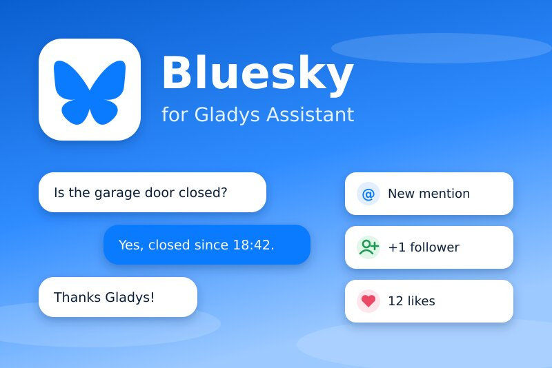
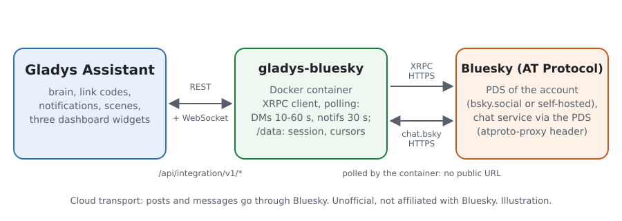
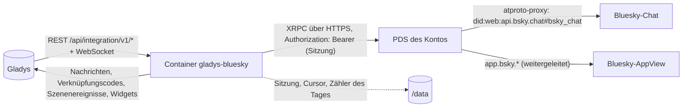
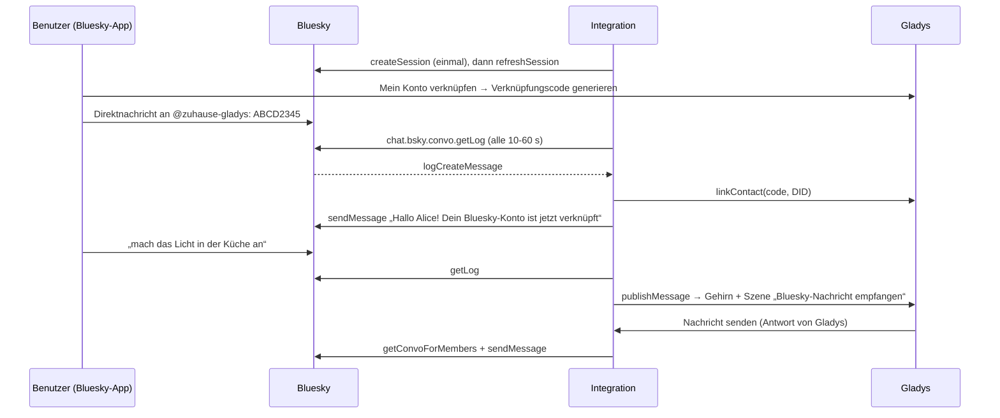
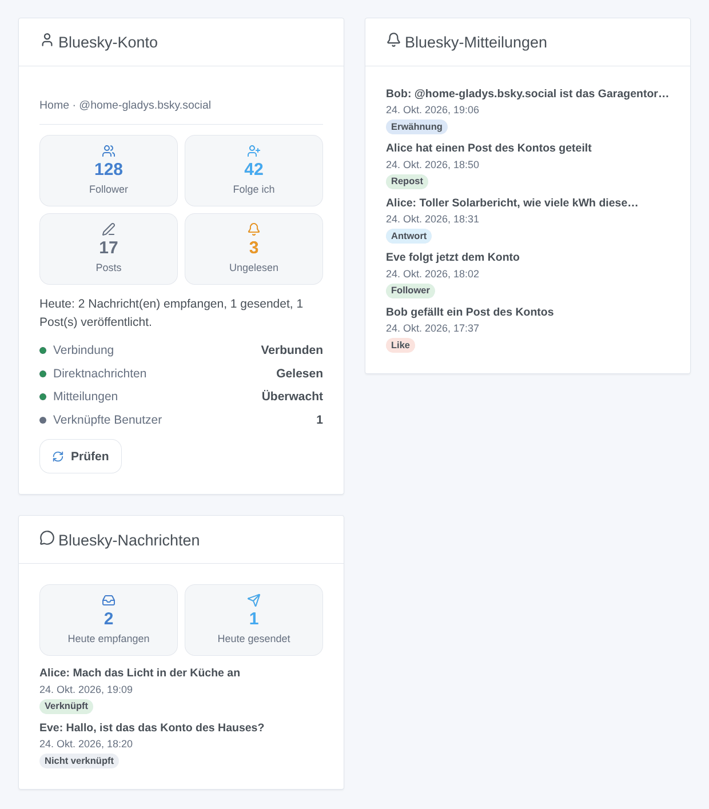

# Gladys Bluesky

[English](README.md) · [Français](README.fr.md) · **Deutsch** · [Español](README.es.md)

[](LICENSE)
[](https://github.com/William-De71/gladys-bluesky/releases)
[](https://github.com/William-De71/gladys-bluesky/actions/workflows/release.yml)
[](https://gladysassistant.com)



Externe Integration für [Gladys Assistant](https://gladysassistant.com) für **Bluesky**: Schreib mit Gladys per Bluesky-Direktnachricht, erhalte dort ihre Mitteilungen, veröffentliche Posts aus deinen Szenen und lass sie auf Erwähnungen, Antworten, neue Follower, Likes und Reposts reagieren. Sie nutzt die offizielle API des AT-Protokolls mit einem **App-Passwort**: kein Webhook, keine öffentliche URL, kein Gladys Plus.

Benutzerdokumentation: [English](docs/en.md) · [Français](docs/fr.md) · [Deutsch](docs/de.md) · [Español](docs/es.md).

**Inoffizielle Integration, ohne Verbindung zu Bluesky Social PBC.** **Noch nicht mit einem echten Bluesky-Konto getestet**: Sie wird gegen einen nachgebauten PDS getestet, der auf den offiziellen Lexicons und der Dokumentation von Bluesky (docs.bsky.app) beruht.

## Funktionen

- **Ein Bluesky-Konto für das Haus** (empfohlen: ein eigenes Konto, z. B. `zuhause-gladys.bsky.social`), geöffnet mit einem App-Passwort, das Direktnachrichten lesen darf. Die Sitzung wird in `/data` gespeichert und erneuert (Bluesky erlaubt 300 Anmeldungen pro Tag): keine neue Anmeldung bei jedem Neustart. Konten auf einem selbst gehosteten PDS funktionieren auch.
- **Mit Gladys schreiben**: Jeder Benutzer verknüpft sein eigenes Bluesky-Konto mit dem Verknüpfungscode von Gladys, den er per Direktnachricht sendet; seine Nachrichten gehen dann an Gladys, die in derselben Unterhaltung antwortet, wie bei der nativen Telegram-Integration. Mitteilungen von Gladys kommen dort ebenfalls an.
- **Standardmäßig sicher**: Nachrichten nicht verknüpfter Konten erreichen Gladys nie und erhalten keine automatische Antwort (sie lösen nur einen eigenen Szenenauslöser aus); Nachrichten des Kontos selbst, Gruppenunterhaltungen und mehr als 15 Minuten zu spät gelesene Nachrichten werden ignoriert.
- **9 Szenenauslöser** (Erwähnung, Antwort, Zitat, neuer Follower, Like, Repost, Nachricht eines verknüpften Benutzers, Nachricht eines fremden Kontos, Nachricht nicht gesendet), **3 Szenenaktionen** (Post veröffentlichen, Direktnachricht senden, Post löschen) und **3 Dashboard-Widgets** (Konto, Mitteilungen, Direktnachrichten).
- **Reichhaltige Posts**: Links, `#Hashtags` und `@Erwähnungen` werden anklickbar (Facetten in UTF-8-Bytes berechnet, Erwähnungen in DIDs aufgelöst), Sprache des Posts, Antwort in einem Thread, optionales Bild mit Alternativtext.
- **Innerhalb der Grenzen von Bluesky**: Direktnachrichten alle 10 bis 60 s gelesen, Mitteilungen alle 30 s, Pause bei HTTP 429 bis `ratelimit-reset`, Flutschutz bei den Szenenaktionen (derselbe Post einmal pro Minute, höchstens 30 Posts pro Stunde).
- Überall vier Sprachen: Englisch, Französisch, Deutsch, Spanisch.

## Funktionsweise





Vom Verknüpfungscode zur Unterhaltung:



### Transport

`transports: ["cloud"]`: Alles läuft über Bluesky. Die Integration ruft die XRPC-API des PDS des Kontos auf (aus dem DID-Dokument der Anmeldung gelesen: `bsky.social` ist nur der Einstiegspunkt), per HTTPS, mit dem Sitzungstoken im Header `Authorization`; Direktnachrichten laufen über denselben PDS mit dem Header `atproto-proxy` zum Chat-Dienst von Bluesky. Die mit Gladys ausgetauschten Nachrichten laufen also über die Server von Bluesky, und Posts sind öffentlich. Das App-Passwort ist ein `secret`-Feld von Gladys, wird nie protokolliert und nie in `/data` geschrieben; `/data` enthält die Sitzung (DID, PDS, Zugriffs- und Erneuerungstoken, Dateimodus 600), die Cursor der Mitteilungen und Nachrichten und die Zähler des Tages.

## App-Passwort erstellen

1. Erstelle (oder wähle) das Bluesky-Konto des Hauses und melde dich damit in der Bluesky-App an.
2. **Einstellungen → Privatsphäre und Sicherheit → App-Passwörter → App-Passwort hinzufügen**, nenne es `Gladys`, aktiviere **Zugriff auf deine Direktnachrichten erlauben**, erstelle es und kopiere es (es wird nur einmal angezeigt).
3. Wähle in den Chat-Einstellungen des Kontos (**Chat → ⚙**, „Neue Nachrichten erlauben von“), wer ihm schreiben darf: **Allen** erlaubt deiner Familie, einen Verknüpfungscode zu senden, ohne vorher gefolgt zu werden.
4. In Gladys: Integrationen → Bluesky → Konfiguration, Handle (oder E-Mail) und App-Passwort eingeben, speichern.

Gib nie das Hauptpasswort des Kontos ein: Ein durch einen E-Mail-Code (2FA) geschütztes Konto lehnt es ohnehin ab, und ein App-Passwort lässt sich einzeln widerrufen.

## Szenenauslöser, Aktionen und Widgets



Die Bilder sind **generierte Illustrationen**, gezeichnet aus dem echten Widget-Code mit erfundenen Konten und Nachrichten, keine Screenshots.

**Widgets**:

- **Bluesky-Konto**: Follower, Abos, Posts, ungelesene Mitteilungen, Nachrichten und Posts des Tages, Verbindung, Zustand der Direktnachrichten und Mitteilungen, verknüpfte Benutzer und eine Schaltfläche **Prüfen**.
- **Bluesky-Mitteilungen**: die letzten 8 Erwähnungen, Antworten, Zitate, Follower, Likes und Reposts mit Link zu bsky.app (Einstellung: Likes und Reposts ausblenden).
- **Bluesky-Nachrichten**: heute empfangene und gesendete Direktnachrichten und die letzten 8 Nachrichten; ihr Text nur mit der Einstellung **Text der Nachrichten anzeigen** (standardmäßig aus: Ein Dashboard kann geteilt sein; nur im Speicher gehalten).

**Szenenauslöser** (ein Ereignis pro neuem Element, nie was beim ersten Lesen schon da war, nie wegen einer Szenenaktion):

| Auslöser                         | Filter                        | Variablen                                                                                                 |
| -------------------------------- | ----------------------------- | --------------------------------------------------------------------------------------------------------- |
| Auf Bluesky erwähnt              | Handle des Autors             | Handle, Name und DID des Autors, Text, AT-URI und Link des Posts                                          |
| Bluesky-Antwort erhalten         | Handle des Autors             | dieselben, dazu AT-URI und Link des Posts des Kontos                                                      |
| Bluesky-Post zitiert             | Handle des Autors             | dieselben wie bei einer Antwort                                                                           |
| Neuer Bluesky-Follower           | Handle des Autors             | Handle, Name und DID des Autors, Link zum Profil                                                          |
| Bluesky-Like erhalten            | Handle des Autors             | Handle, Name und DID des Autors, AT-URI und Link des gelikten Posts                                       |
| Bluesky-Repost erhalten          | Handle des Autors             | dieselben wie bei einem Like                                                                              |
| Bluesky-Nachricht empfangen      | Gladys-Benutzer, genauer Text | Text, Handle, Name und DID des Absenders, Gladys-Benutzer und Vorname, IDs von Unterhaltung und Nachricht |
| Nachricht eines fremden Kontos   | Handle des Absenders          | Text, Handle, Name und DID des Absenders, IDs von Unterhaltung und Nachricht                              |
| Bluesky-Nachricht nicht gesendet | Ursache, Gladys-Benutzer      | DID und Handle des Benutzers, Gladys-Benutzer, Vorname, Ursache, Bluesky-Fehlercode                       |

**Szenenaktionen**:

- **Bluesky-Post veröffentlichen**: Text (300 Zeichen, darüber mit … gekürzt), Sprache (leer: die Sprache der Integration), Antworten auf (ein bsky.app-Link oder eine `at://`-URI, z. B. `{{triggerEvent.data.post_uri}}`), optionale Bild-URL (JPEG, PNG, WebP oder GIF, 2 MB) und ihre Beschreibung. Ausgaben: `uri`, `url`, `cid`. Derselbe Post innerhalb einer Minute wird einmal veröffentlicht; höchstens 30 Posts pro Stunde (eine Szene in einer Schleife hält dort an).
- **Bluesky-Direktnachricht senden**: an ein Handle, eine DID oder einen Profillink, verknüpft oder nicht (es muss Nachrichten des Kontos annehmen). Ausgaben: `convo_id`, `message_id`. Dieselbe Nachricht an dasselbe Konto innerhalb einer Minute wird einmal gesendet.
- **Bluesky-Post löschen**: ein Post des Kontos, z. B. die Ausgabe `url` einer früheren Veröffentlichung.

Beispiele:

- **Auf Bluesky erwähnt** von `alice.bsky.social` → **Bluesky-Post veröffentlichen** „Die Garage ist zu ✅“ mit **Antworten auf** `{{triggerEvent.data.post_uri}}`.
- Jeden Abend um 21 Uhr → **Bluesky-Post veröffentlichen** „Solarertrag heute: {{…}} kWh #solar“.
- **Neuer Bluesky-Follower** → eine Mitteilung auf dein Handy mit `{{triggerEvent.data.author_name}}`.

## Voraussetzungen

- Gladys Assistant **5.3.0** oder neuer (Dashboard-Widgets, Szenenauslöser und -aktionen, Katalog-Schlüsselwörter von Gladys 5.3): Ältere Instanzen können die Integration nicht installieren.
- Ein Bluesky-Konto (bsky.social oder ein selbst gehosteter PDS) und ein App-Passwort mit Zugriff auf Direktnachrichten.
- Internetzugang von Gladys aus (nur ausgehend: kein Port zu öffnen).

## Installation

- **Aus dem Store**: Integrationen → Bluesky → Installieren.
- **Über die URL des Repositorys**: Integrationen → Von einer URL installieren → `https://github.com/William-De71/gladys-bluesky`.
- **Entwicklermodus**: Starte den Container selbst mit den Variablen, die Gladys anzeigt (siehe Entwicklung).

## Konfiguration

| Feld                               | Standard              | Bedeutung                                                                                    |
| ---------------------------------- | --------------------- | -------------------------------------------------------------------------------------------- |
| Handle oder E-Mail des Kontos      | —                     | Pflicht: `name.bsky.social`, deine eigene Domain oder die E-Mail-Adresse                     |
| App-Passwort                       | —                     | Pflicht, geheim, mit Zugriff auf Direktnachrichten                                           |
| Server (erweitert)                 | `https://bsky.social` | für ein Konto auf einem selbst gehosteten PDS: seine `https://`-Adresse                      |
| Direktnachrichten lesen            | an                    | aus: Niemand kann mit Gladys schreiben oder ein Konto verknüpfen (Gladys kann weiter senden) |
| Direktnachrichten an Gladys senden | an                    | aus: Nachrichten verknüpfter Benutzer erreichen nur die Szenen                               |
| Direktnachrichten prüfen alle      | 15 s                  | 10, 15, 30 oder 60 s (Mitteilungen: alle 30 s, 60 s bei der Wahl 60 s)                       |
| Mitteilungen überwachen            | an                    | Erwähnungen, Antworten, Zitate, Follower, Likes, Reposts (nie als gelesen markiert)          |
| Sprache der Integration            | automatisch           | die Antwort auf einen Verknüpfungscode und die Standardsprache der Posts                     |

**Verbindung testen** (Schaltfläche der Konfiguration) öffnet die Sitzung (auch nach einem abgelehnten Passwort), liest das Profil, prüft den Zugriff auf Direktnachrichten und zählt die verknüpften Benutzer.

## Verwendung

1. Erstelle das App-Passwort (oben) und fülle die Konfiguration aus.
2. Jeder Benutzer: **Mein Konto verknüpfen → Verknüpfungscode generieren** in der Konfiguration der Integration, dann den Code innerhalb von 15 Minuten per Direktnachricht an das Konto des Hauses senden.
3. Schreib dem Konto des Hauses: Gladys antwortet. Erlaube seine Nachrichten in deinen eigenen Chat-Einstellungen, um die Meldungen von Gladys zu erhalten.
4. Füge die Widgets einem Dashboard hinzu; baue Szenen mit den Auslösern und Aktionen.

## Entwicklung

```bash
npm install
npm test                       # node --test, ein nachgebauter PDS auf 127.0.0.1, nie das Netz
npm run lint                   # ESLint
npm run format:check           # Prettier
npm run coverage               # node --test mit Abdeckung von src/
npx github:GladysAssistant/integration-store . --skip-image-check
scripts/build-cover.sh         # cover.jpg aus docs/assets/cover.svg
docs/illustrations/render.sh   # docs/assets/widgets.<lang>.png
```

Lokal liest das SDK `GLADYS_HOST_API_URL`, `GLADYS_INTEGRATION_TOKEN` und `GLADYS_INTEGRATION_SELECTOR` (von Gladys im Entwicklermodus angezeigt). `DEBUG=gladys-integration-sdk` zeigt die Protokolle des SDK. Der Text einer Nachricht wird nie protokolliert.

Die Tests decken den Rich Text ab (Grapheme, UTF-8-Facetten, Links, Hashtags, Erwähnungen, Aufteilen), die Links und AT-URIs, die Konfiguration, die Sitzung (createSession nur einmal, refreshSession, gespeicherte Sitzung wiederverwendet, abgelehntes Passwort nie allein erneut versucht, 2FA, App-Passwort ohne Direktnachrichten), die Ratenbegrenzung (429 und `ratelimit-reset`), die Bilder, `/data` und die ganze Integration gegen das nachgebaute Gladys des SDK und den nachgebauten PDS: Referenzen, Verknüpfung, Unterhaltung, Fremde, verspätete Nachrichten, Fehler, Mitteilungen, die drei Aktionen, die Widgets und die Schaltfläche der Konfiguration. `test/structure.test.js` friert jeden Schlüssel ein, den Benutzer speichern.

## Release-Prozess


Jeder Merge auf `main` startet die CI und berechnet dann die Version aus den [Conventional Commits](https://www.conventionalcommits.org/) seit dem letzten Tag: `feat` → Minor, `fix` / `perf` → Patch, `!` oder `BREAKING CHANGE` → Major (unter 1.0.0 ein Minor); `docs`, `chore`, `ci`, `test`, `style`, `refactor`, `build` allein veröffentlichen nichts. Der Changelog-Abschnitt wird erzeugt, das Tag gepusht, das Multi-Architektur-Image gebaut, dann erhält `main` den Release-Commit, die GitHub Release wird erstellt und ein letzter Job prüft das öffentliche Image, den Store-Validator und das Topic.

- Der Titel des Pull Requests wird zum Squash-Commit und dann zur Changelog-Zeile: Schreib ihn auf Englisch, für den Benutzer (`pr-title.yml` prüft ihn). Bearbeite `CHANGELOG.md` nie von Hand.
- 1.0.0 ist eine Entscheidung: Actions → Release → Run workflow mit `release-as: 1.0.0`. `dry-run` zeigt Version und Notizen, ohne etwas zu veröffentlichen.
- **Geschützter Branch**: Die Release pusht ihren Commit mit `GITHUB_TOKEN` auf `main`. Das Ruleset `protect-main` (kein Löschen, kein Force-Push) lässt ihn durch; eine strengere Regel (Pull Request Pflicht, Status Checks) bräuchte GitHub Actions in ihrer Ausnahmeliste oder eine GitHub App.
- Mache nach der ersten Release das Paket auf `ghcr.io` öffentlich (Package settings → Change visibility), sonst kann Gladys es nicht herunterladen.

## Fehlerbehebung

Siehe [docs/de.md](docs/de.md#fehlerbehebung). Melde Probleme mit den Versionen von Gladys und der Integration, der Meldung von **Verbindung testen** und den Protokollen mit `DEBUG=gladys-integration-sdk`. Füge nie das App-Passwort oder private Nachrichten ein.

## Mitwirken

Issues und Pull Requests sind willkommen. Führe `npm run format:check && npm run lint && npm test` aus, bevor du einen Pull Request öffnest, und ändere keinen gespeicherten Schlüssel (siehe [CLAUDE.md](CLAUDE.md)). Ein Test mit einem echten Konto (Protokolle ohne Passwort) hilft am meisten.

## Sicherheit

Siehe [SECURITY.md](SECURITY.md): Melde Schwachstellen vertraulich. Das App-Passwort ist ein `secret`-Feld, wird nur bei der Anmeldung an den konfigurierten Server gesendet, nie protokolliert und nie in `/data` geschrieben; die Sitzungstoken in `/data/session.json` kann nur der Container lesen (Modus 600). Nur verknüpfte Benutzer erreichen das Gehirn von Gladys und damit die Rechte ihres Gladys-Benutzers: Verknüpfe nur Personen, denen du vertraust. Das Bild eines Posts wird öffentlich: Lass es nie auf eine Kamera des Hauses zeigen.

## Screenshots folgen

Die Bilder oben sind Illustrationen, keine Screenshots. Echte Screenshots kommen nach `docs/assets/screenshots/` (PNG, 1280 × 800): `configuration.png` (die Kontofelder und Hilfeabschnitte), `app-password.png` (der App-Passwort-Bildschirm von Bluesky mit dem Kästchen für Direktnachrichten), `link.png` (der per Direktnachricht gesendete Verknüpfungscode), `conversation.png` (eine Unterhaltung mit Gladys in der Bluesky-App), `scene-mention.png` (der Auslöser „Auf Bluesky erwähnt“ in einer Szene).

## Bekannte Grenzen

- Nie mit einem echten Konto getestet: Die Daten folgen den offiziellen Lexicons und der Dokumentation von Bluesky, nicht einer echten Sitzung.
- Nur regelmäßige Abfrage (Bluesky schickt nichts an einen Heimserver): Eine Direktnachricht erreicht Gladys innerhalb des gewählten Intervalls (standardmäßig 15 s).
- Bilder können nicht in einer Bluesky-Direktnachricht übertragen werden (die Chat-API kennt keine Bilder): Ein von Gladys gesendetes Kamerabild kommt als kurzer Hinweis an.
- Gruppenunterhaltungen, Reaktionen sowie Mitteilungen zu Starter-Packs, Verifizierungen und abonnierten Posts werden nicht unterstützt.
- Mitteilungen bleiben in der Bluesky-App ungelesen (die Integration markiert sie nie als gesehen); der Zähler der ungelesenen ist der von Bluesky.
- Ein Verknüpfungscode läuft nach 15 Minuten ab (Gladys).

## Lizenz

[Apache License 2.0](LICENSE) — siehe auch [NOTICE](NOTICE). Bluesky und das Schmetterlingslogo sind Marken von Bluesky Social PBC; dieses Projekt steht in keiner Verbindung dazu. Der Schmetterling des Titelbilds stammt unverändert aus [bluesky-social/social-app](https://github.com/bluesky-social/social-app) (`bskyembed/assets/logo.svg`). Danke an die Dokumentation und das SDK von Gladys sowie an die Dokumentation und die Lexicons von Bluesky (siehe NOTICE).
