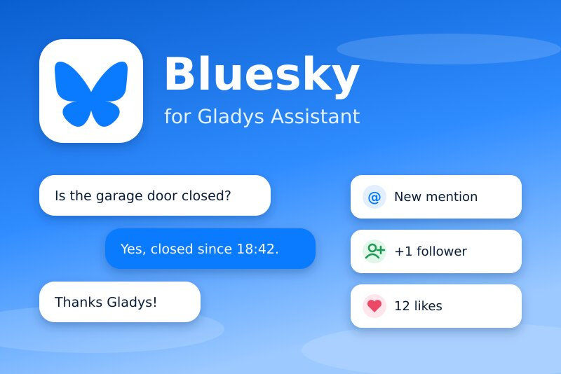
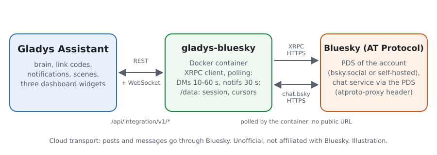
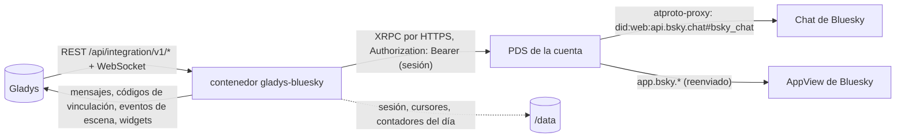
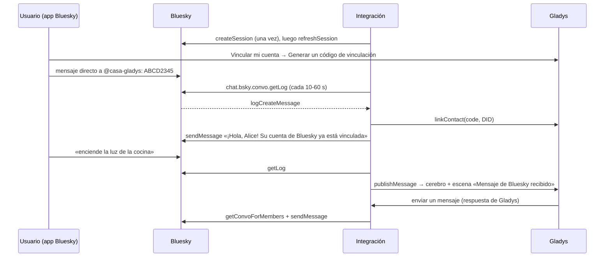
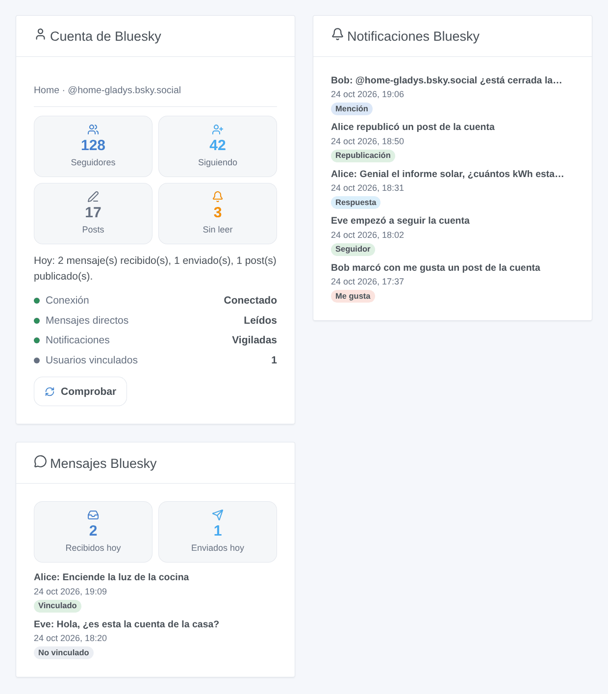

# Gladys Bluesky

[English](README.md) · [Français](README.fr.md) · [Deutsch](README.de.md) · **Español**

[](LICENSE)
[](https://github.com/William-De71/gladys-bluesky/releases)
[](https://github.com/William-De71/gladys-bluesky/actions/workflows/release.yml)
[](https://gladysassistant.com)



Integración externa de [Gladys Assistant](https://gladysassistant.com) para **Bluesky**: hable con Gladys por mensajes directos de Bluesky, reciba allí sus notificaciones, publique posts desde sus escenas y haga que reaccionen a menciones, respuestas, nuevos seguidores, me gusta y republicaciones. Usa la API oficial del protocolo AT con una **contraseña de aplicación**: sin webhook, sin URL pública, sin Gladys Plus.

Documentación de usuario: [English](docs/en.md) · [Français](docs/fr.md) · [Deutsch](docs/de.md) · [Español](docs/es.md).

**Integración no oficial, sin relación con Bluesky Social PBC.** **Aún no probada con una cuenta real de Bluesky**: se prueba contra un PDS simulado construido a partir de los lexicons oficiales y de la documentación de Bluesky (docs.bsky.app).

## Funciones

- **Una cuenta de Bluesky para la casa** (recomendado: una cuenta dedicada, p. ej. `casa-gladys.bsky.social`), abierta con una contraseña de aplicación autorizada a leer los mensajes directos. La sesión se guarda en `/data` y se renueva (Bluesky permite 300 inicios de sesión al día): no hay un nuevo inicio de sesión en cada reinicio. Las cuentas en un PDS autoalojado también funcionan.
- **Hablar con Gladys**: cada usuario vincula su propia cuenta de Bluesky con el código de vinculación de Gladys enviado por mensaje directo; sus mensajes llegan entonces a Gladys, que responde en la misma conversación, como la integración nativa de Telegram. Las notificaciones de Gladys también llegan allí.
- **Segura por defecto**: los mensajes de cuentas no vinculadas nunca llegan a Gladys y no reciben respuesta automática (solo activan un disparador de escena dedicado); los mensajes de la propia cuenta, las conversaciones de grupo y los mensajes leídos con más de 15 minutos de retraso se ignoran.
- **9 disparadores de escena** (mención, respuesta, cita, nuevo seguidor, me gusta, republicación, mensaje de un usuario vinculado, mensaje de una cuenta no vinculada, mensaje no enviado), **3 acciones de escena** (publicar un post, enviar un mensaje directo, eliminar un post) y **3 widgets del panel** (cuenta, notificaciones, mensajes directos).
- **Posts enriquecidos**: enlaces, `#hashtags` y `@menciones` se vuelven clicables (facetas calculadas en bytes UTF-8, menciones resueltas en DID), idioma del post, respuesta en un hilo, imagen opcional con su texto alternativo.
- **Dentro de los límites de Bluesky**: mensajes directos leídos cada 10 a 60 s, notificaciones cada 30 s, pausa ante HTTP 429 hasta `ratelimit-reset`, protección contra ráfagas en las acciones de escena (el mismo post una vez por minuto, 30 posts por hora como máximo).
- Cuatro idiomas en todas partes: inglés, francés, alemán, español.

## Cómo funciona





Del código de vinculación a la conversación:



### Transporte

`transports: ["cloud"]`: todo pasa por Bluesky. La integración llama a la API XRPC del PDS de la cuenta (leído en el documento DID devuelto al iniciar sesión: `bsky.social` es solo el punto de entrada), por HTTPS, con el token de sesión en la cabecera `Authorization`; los mensajes directos pasan por el mismo PDS con la cabecera `atproto-proxy` hacia el servicio de chat de Bluesky. Los mensajes intercambiados con Gladys pasan por tanto por los servidores de Bluesky, y los posts son públicos. La contraseña de aplicación es un campo `secret` de Gladys, nunca registrado ni escrito en `/data`; `/data` contiene la sesión (DID, PDS, tokens de acceso y de renovación, archivo en modo 600), los cursores de las notificaciones y de los mensajes y los contadores del día.

## Crear la contraseña de aplicación

1. Cree (o elija) la cuenta de Bluesky de la casa e inicie sesión con ella en la app de Bluesky.
2. **Ajustes → Privacidad y seguridad → Contraseñas de aplicación → Añadir contraseña de aplicación**, llámela `Gladys`, marque **Permitir el acceso a tus mensajes directos**, créela y cópiela (solo se muestra una vez).
3. En los ajustes de chat de la cuenta (**Chat → ⚙**, «Permitir mensajes nuevos de»), elija quién puede escribirle: **Todos** permite a su familia enviar un código de vinculación sin que la cuenta la siga antes.
4. En Gladys: Integraciones → Bluesky → Configuración, introduzca el alias (o el correo) y la contraseña de aplicación y guarde.

No introduzca nunca la contraseña principal de la cuenta: una cuenta protegida por un código enviado por correo (2FA) la rechaza de todos modos, y una contraseña de aplicación se puede revocar sola.

## Disparadores, acciones de escena y widgets



Las imágenes son **ilustraciones generadas**, dibujadas a partir del código real de los widgets con cuentas y mensajes inventados, no capturas de pantalla.

**Widgets**:

- **Cuenta de Bluesky**: seguidores, seguidos, posts, notificaciones sin leer, mensajes y posts del día, conexión, estado de los mensajes directos y de las notificaciones, usuarios vinculados y un botón **Comprobar**.
- **Notificaciones Bluesky**: las últimas 8 menciones, respuestas, citas, seguidores, me gusta y republicaciones, con enlace a bsky.app (ajuste: ocultar me gusta y republicaciones).
- **Mensajes Bluesky**: mensajes directos recibidos y enviados hoy y los últimos 8 mensajes; su texto solo con el ajuste **Mostrar el texto de los mensajes** (desactivado por defecto: un panel puede compartirse; solo se guardan en memoria).

**Disparadores de escena** (un evento por cada elemento nuevo, nunca lo que ya estaba en la primera lectura, nunca por una acción de escena):

| Disparador                        | Filtros                         | Variables                                                                                                       |
| --------------------------------- | ------------------------------- | --------------------------------------------------------------------------------------------------------------- |
| Mencionado en Bluesky             | alias del autor                 | alias, nombre y DID del autor, texto, URI AT y enlace del post                                                  |
| Respuesta de Bluesky recibida     | alias del autor                 | los mismos, más la URI AT y el enlace del post de la cuenta                                                     |
| Post de Bluesky citado            | alias del autor                 | los mismos que para una respuesta                                                                               |
| Nuevo seguidor de Bluesky         | alias del autor                 | alias, nombre y DID del autor, enlace al perfil                                                                 |
| Me gusta de Bluesky recibido      | alias del autor                 | alias, nombre y DID del autor, URI AT y enlace del post que gustó                                               |
| Republicación de Bluesky recibida | alias del autor                 | los mismos que para un me gusta                                                                                 |
| Mensaje de Bluesky recibido       | usuario de Gladys, texto exacto | texto, alias, nombre y DID del remitente, usuario de Gladys y nombre, identificadores de conversación y mensaje |
| Mensaje de cuenta no vinculada    | alias del remitente             | texto, alias, nombre y DID del remitente, identificadores de conversación y mensaje                             |
| Mensaje de Bluesky no enviado     | causa, usuario de Gladys        | DID y alias del usuario, usuario de Gladys, nombre, causa, código de error de Bluesky                           |

**Acciones de escena**:

- **Publicar un post de Bluesky**: texto (300 caracteres, acortado con … si se supera), idioma (vacío: el idioma de la integración), responder a (un enlace de bsky.app o una URI `at://`, p. ej. `{{triggerEvent.data.post_uri}}`), URL de imagen opcional (JPEG, PNG, WebP o GIF, 2 MB) y su descripción. Salidas: `uri`, `url`, `cid`. El mismo post en menos de un minuto se publica una vez; 30 posts por hora como máximo (una escena en bucle se detiene ahí).
- **Enviar un mensaje directo de Bluesky**: a un alias, un DID o un enlace de perfil, vinculado o no (debe aceptar los mensajes de la cuenta). Salidas: `convo_id`, `message_id`. El mismo mensaje a la misma cuenta en menos de un minuto se envía una vez.
- **Eliminar un post de Bluesky**: un post de la cuenta, p. ej. la salida `url` de una publicación anterior.

Ejemplos:

- **Mencionado en Bluesky** por `alice.bsky.social` → **Publicar un post de Bluesky** «El garaje está cerrado ✅» con **Responder a** `{{triggerEvent.data.post_uri}}`.
- Cada noche a las 21:00 → **Publicar un post de Bluesky** «Producción solar de hoy: {{…}} kWh #solar».
- **Nuevo seguidor de Bluesky** → una notificación en su teléfono con `{{triggerEvent.data.author_name}}`.

## Requisitos

- Gladys Assistant **5.3.0** o posterior (widgets del panel, disparadores y acciones de escena, palabras clave del catálogo de Gladys 5.3): las instancias más antiguas no pueden instalar la integración.
- Una cuenta de Bluesky (bsky.social o un PDS autoalojado) y una contraseña de aplicación con acceso a los mensajes directos.
- Acceso a Internet desde Gladys (solo saliente: ningún puerto que abrir).

## Instalación

- **Desde la tienda**: Integraciones → Bluesky → Instalar.
- **Desde la URL del repositorio**: Integraciones → Instalar desde una URL → `https://github.com/William-De71/gladys-bluesky`.
- **Modo desarrollador**: lance el contenedor usted mismo con las variables que muestra Gladys (ver Desarrollo).

## Configuración

| Campo                                 | Por defecto           | Significado                                                                                      |
| ------------------------------------- | --------------------- | ------------------------------------------------------------------------------------------------ |
| Alias o correo de la cuenta           | —                     | obligatorio: `nombre.bsky.social`, su propio dominio o la dirección de correo                    |
| Contraseña de aplicación              | —                     | obligatoria, secreta, con acceso a los mensajes directos                                         |
| Servidor (avanzado)                   | `https://bsky.social` | para una cuenta en un PDS autoalojado: su dirección `https://`                                   |
| Leer los mensajes directos            | activado              | desactivado: nadie puede hablar con Gladys ni vincular una cuenta (Gladys aún puede enviar)      |
| Enviar los mensajes directos a Gladys | activado              | desactivado: los mensajes de los usuarios vinculados solo llegan a las escenas                   |
| Comprobar los mensajes directos cada  | 15 s                  | 10, 15, 30 o 60 s (notificaciones: cada 30 s, 60 s con la opción de 60 s)                        |
| Vigilar las notificaciones            | activado              | menciones, respuestas, citas, seguidores, me gusta, republicaciones (nunca marcadas como leídas) |
| Idioma de la integración              | automático            | la respuesta a un código de vinculación y el idioma por defecto de los posts                     |

**Probar la conexión** (botón de la configuración) abre la sesión (también tras una contraseña rechazada), lee el perfil, comprueba el acceso a los mensajes directos y cuenta los usuarios vinculados.

## Uso

1. Cree la contraseña de aplicación (arriba) y complete la configuración.
2. Cada usuario: **Vincular mi cuenta → Generar un código de vinculación** en la configuración de la integración y envíe el código por mensaje directo a la cuenta de la casa en un plazo de 15 minutos.
3. Escriba a la cuenta de la casa: Gladys responde. Permita sus mensajes en sus propios ajustes de chat para recibir los avisos de Gladys.
4. Añada los widgets a un panel; cree escenas con los disparadores y las acciones.

## Desarrollo

```bash
npm install
npm test                       # node --test, un PDS simulado en 127.0.0.1, nunca la red
npm run lint                   # ESLint
npm run format:check           # Prettier
npm run coverage               # node --test con la cobertura de src/
npx github:GladysAssistant/integration-store . --skip-image-check
scripts/build-cover.sh         # cover.jpg desde docs/assets/cover.svg
docs/illustrations/render.sh   # docs/assets/widgets.<lang>.png
```

En local, el SDK lee `GLADYS_HOST_API_URL`, `GLADYS_INTEGRATION_TOKEN` y `GLADYS_INTEGRATION_SELECTOR` (que Gladys muestra en modo desarrollador). `DEBUG=gladys-integration-sdk` muestra los registros del SDK. El texto de un mensaje nunca se registra.

Las pruebas cubren el texto enriquecido (grafemas, facetas UTF-8, enlaces, hashtags, menciones, división), los enlaces y URI AT, la configuración, la sesión (createSession una sola vez, refreshSession, sesión guardada reutilizada, contraseña rechazada nunca reintentada sola, 2FA, contraseña de aplicación sin mensajes directos), los límites de frecuencia (429 y `ratelimit-reset`), las imágenes, `/data` y toda la integración contra el Gladys simulado del SDK y el PDS simulado: referencias, vinculación, conversación, desconocidos, mensajes con retraso, fallos, notificaciones, las tres acciones, los widgets y el botón de configuración. `test/structure.test.js` congela cada clave que guardan los usuarios.

## Proceso de publicación


Cada fusión en `main` lanza la CI y luego calcula la versión a partir de los [Conventional Commits](https://www.conventionalcommits.org/) desde la última etiqueta: `feat` → menor, `fix` / `perf` → parche, `!` o `BREAKING CHANGE` → mayor (una menor por debajo de 1.0.0); `docs`, `chore`, `ci`, `test`, `style`, `refactor`, `build` solos no publican nada. Se genera la sección del changelog, se sube la etiqueta, se construye la imagen multiarquitectura, luego `main` recibe el commit de publicación, se crea la GitHub Release y un último job comprueba la imagen pública, el validador de la tienda y el topic.

- El título de la pull request se convierte en el commit de squash y luego en la línea del changelog: escríbalo en inglés, para el usuario (`pr-title.yml` lo comprueba). No edite nunca `CHANGELOG.md` a mano.
- La 1.0.0 es una decisión: Actions → Release → Run workflow con `release-as: 1.0.0`. `dry-run` muestra la versión y las notas sin publicar nada.
- **Rama protegida**: la publicación sube su commit a `main` con `GITHUB_TOKEN`. El ruleset `protect-main` (sin borrado, sin force-push) lo deja pasar; una regla más estricta (pull request obligatoria, status checks) necesitaría GitHub Actions en su lista de excepciones, o una GitHub App.
- Tras la primera publicación, haga público el paquete de `ghcr.io` (Package settings → Change visibility), o Gladys no podrá descargarlo.

## Solución de problemas

Ver [docs/es.md](docs/es.md#solución-de-problemas). Informe de un problema con las versiones de Gladys y de la integración, el mensaje de **Probar la conexión** y los registros con `DEBUG=gladys-integration-sdk`. No pegue nunca la contraseña de aplicación ni mensajes privados.

## Contribuir

Issues y pull requests son bienvenidos. Ejecute `npm run format:check && npm run lint && npm test` antes de abrir una pull request y no cambie ninguna clave guardada (ver [CLAUDE.md](CLAUDE.md)). Una prueba con una cuenta real (registros sin la contraseña) ayuda más que nada.

## Seguridad

Ver [SECURITY.md](SECURITY.md): informe de las vulnerabilidades en privado. La contraseña de aplicación es un campo `secret`, enviado solo al servidor configurado al iniciar sesión, nunca registrado ni escrito en `/data`; los tokens de sesión de `/data/session.json` solo los puede leer el contenedor (modo 600). Solo los usuarios vinculados llegan al cerebro de Gladys, y a través de él a la autoridad de su usuario de Gladys: vincule solo a personas de confianza. La imagen de un post se vuelve pública: no la haga apuntar nunca a una cámara de la casa.

## Capturas pendientes

Las imágenes de arriba son ilustraciones, no capturas de pantalla. Las capturas reales irán en `docs/assets/screenshots/` (PNG, 1280 × 800): `configuration.png` (los campos de la cuenta y las secciones de ayuda), `app-password.png` (la pantalla de contraseñas de aplicación de Bluesky con la casilla de mensajes directos), `link.png` (el código de vinculación enviado por mensaje directo), `conversation.png` (una conversación con Gladys en la app de Bluesky), `scene-mention.png` (el disparador «Mencionado en Bluesky» en una escena).

## Límites conocidos

- Nunca probada con una cuenta real: los intercambios siguen los lexicons oficiales y la documentación de Bluesky, no una sesión real.
- Solo consulta periódica (Bluesky no envía nada a un servidor doméstico): un mensaje directo llega a Gladys dentro del intervalo elegido (15 s por defecto).
- Una imagen no puede viajar en un mensaje directo de Bluesky (la API de chat no tiene imágenes): una imagen de cámara enviada por Gladys llega como un breve aviso.
- No se gestionan las conversaciones de grupo, las reacciones ni las notificaciones de paquetes de inicio, verificación y posts suscritos.
- Las notificaciones siguen sin leer en la app de Bluesky (la integración nunca las marca como vistas); el contador de no leídas es el de Bluesky.
- Un código de vinculación caduca a los 15 minutos (Gladys).

## Licencia

[Licencia Apache 2.0](LICENSE) — ver también [NOTICE](NOTICE). Bluesky y el logotipo de la mariposa son marcas de Bluesky Social PBC; este proyecto no tiene relación con ella. La mariposa de la portada procede sin cambios de [bluesky-social/social-app](https://github.com/bluesky-social/social-app) (`bskyembed/assets/logo.svg`). Gracias a la documentación y al SDK de Gladys, y a la documentación y los lexicons de Bluesky (ver NOTICE).
