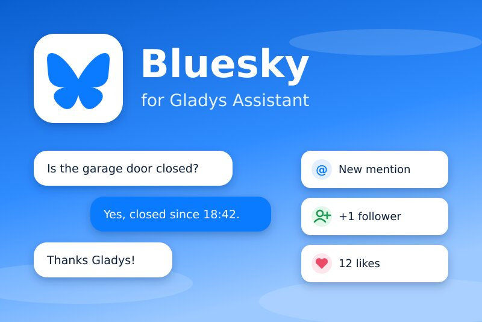
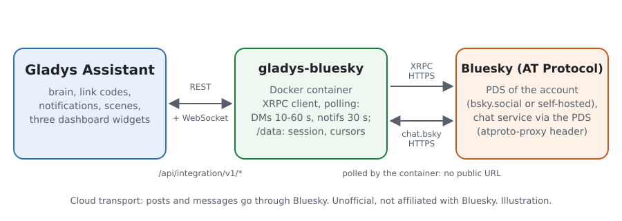
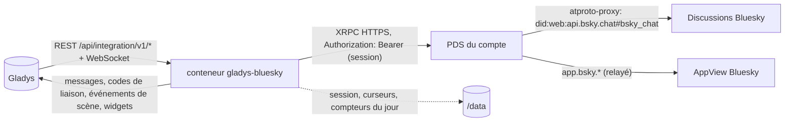
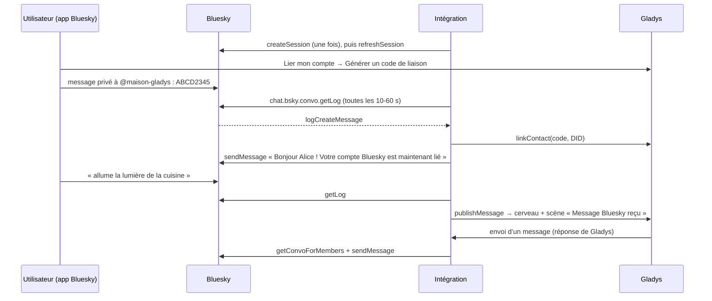
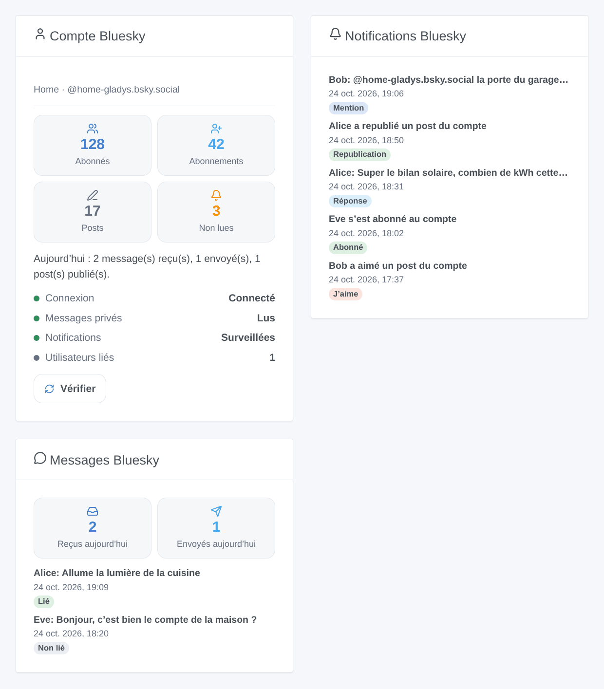

# Gladys Bluesky

[English](README.md) · **Français** · [Deutsch](README.de.md) · [Español](README.es.md)

[](LICENSE)
[](https://github.com/William-De71/gladys-bluesky/releases)
[](https://github.com/William-De71/gladys-bluesky/actions/workflows/release.yml)
[](https://gladysassistant.com)



Intégration externe [Gladys Assistant](https://gladysassistant.com) pour **Bluesky** : parlez à Gladys en messages privés Bluesky, recevez-y ses notifications, publiez des posts depuis vos scènes et faites-les réagir aux mentions, réponses, nouveaux abonnés, j’aime et republications. Elle utilise l’API officielle du protocole AT avec un **mot de passe d’application** : ni webhook, ni URL publique, ni Gladys Plus.

Documentation utilisateur : [English](docs/en.md) · [Français](docs/fr.md) · [Deutsch](docs/de.md) · [Español](docs/es.md).

**Intégration non officielle, sans lien avec Bluesky Social PBC.** **Pas encore testée avec un vrai compte Bluesky** : elle est testée contre un faux PDS construit d’après les lexicons officiels et la documentation de Bluesky (docs.bsky.app).

## Fonctionnalités

- **Un compte Bluesky pour la maison** (conseillé : un compte dédié, ex. `maison-gladys.bsky.social`), ouvert avec un mot de passe d’application autorisé à lire les messages privés. La session est gardée dans `/data` et renouvelée (Bluesky autorise 300 connexions par jour) : pas de nouvelle connexion à chaque redémarrage. Les comptes sur un PDS auto-hébergé fonctionnent aussi.
- **Parler à Gladys** : chaque utilisateur lie son propre compte Bluesky avec le code de liaison de Gladys envoyé en message privé ; ses messages vont ensuite à Gladys, qui répond dans la même conversation, comme l’intégration native Telegram. Les notifications de Gladys y arrivent aussi.
- **Sûre par défaut** : les messages des comptes non liés n’atteignent jamais Gladys et ne reçoivent aucune réponse automatique (ils déclenchent seulement un déclencheur de scène dédié) ; les messages du compte lui-même, les conversations de groupe et les messages lus plus de 15 minutes en retard sont ignorés.
- **9 déclencheurs de scène** (mention, réponse, citation, nouvel abonné, j’aime, republication, message d’un utilisateur lié, message d’un compte non lié, message non envoyé), **3 actions de scène** (publier un post, envoyer un message privé, supprimer un post) et **3 widgets de tableau de bord** (compte, notifications, messages privés).
- **Posts riches** : liens, `#hashtags` et `@mentions` deviennent cliquables (facettes calculées en octets UTF-8, mentions résolues en DID), langue du post, réponse dans un fil, image facultative avec son texte alternatif.
- **Dans les limites de Bluesky** : messages privés lus toutes les 10 à 60 s, notifications toutes les 30 s, pause sur HTTP 429 jusqu’à `ratelimit-reset`, anti-rafale sur les actions de scène (le même post une fois par minute, 30 posts par heure au plus).
- Quatre langues partout : anglais, français, allemand, espagnol.

## Fonctionnement





Du code de liaison à la conversation :



### Transport

`transports: ["cloud"]` : tout passe par Bluesky. L’intégration appelle l’API XRPC du PDS du compte (lu dans le document DID renvoyé à la connexion : `bsky.social` n’est que le point d’entrée), en HTTPS, avec le jeton de session dans l’en-tête `Authorization` ; les messages privés passent par le même PDS avec l’en-tête `atproto-proxy` vers le service de discussion de Bluesky. Les messages échangés avec Gladys passent donc par les serveurs de Bluesky, et les posts sont publics. Le mot de passe d’application est un champ `secret` de Gladys, jamais journalisé ni écrit dans `/data` ; `/data` contient la session (DID, PDS, jetons d’accès et de renouvellement, fichier en mode 600), les curseurs des notifications et des messages et les compteurs du jour.

## Créer le mot de passe d’application

1. Créez (ou choisissez) le compte Bluesky de la maison et connectez-vous avec lui dans l’app Bluesky.
2. **Réglages → Confidentialité et sécurité → Mots de passe d’application → Ajouter un mot de passe d’application**, nommez-le `Gladys`, cochez **Autoriser l’accès à vos messages privés**, créez-le et copiez-le (il n’est affiché qu’une fois).
3. Dans les réglages de discussion du compte (**Discussions → ⚙**, « Autoriser les nouveaux messages de »), choisissez qui peut lui écrire : **Tout le monde** permet à votre famille d’envoyer un code de liaison sans être suivie d’abord.
4. Dans Gladys : Intégrations → Bluesky → Configuration, saisissez le pseudo (ou l’e-mail) et le mot de passe d’application, enregistrez.

Ne saisissez jamais le mot de passe principal du compte : un compte protégé par un code envoyé par e-mail (2FA) le refuse de toute façon, et un mot de passe d’application se révoque seul.

## Déclencheurs, actions de scène et widgets



Les images sont des **illustrations générées**, dessinées à partir du vrai code des widgets sur des comptes et des messages inventés, pas des captures d’écran.

**Widgets** :

- **Compte Bluesky** : abonnés, abonnements, posts, notifications non lues, messages et posts du jour, connexion, état des messages privés et des notifications, utilisateurs liés et un bouton **Vérifier**.
- **Notifications Bluesky** : les 8 dernières mentions, réponses, citations, abonnés, j’aime et republications, avec un lien vers bsky.app (réglage : masquer j’aime et republications).
- **Messages Bluesky** : messages privés reçus et envoyés aujourd’hui et les 8 derniers messages ; leur texte seulement avec le réglage **Afficher le texte des messages** (désactivé par défaut : un tableau de bord peut être partagé ; gardés en mémoire seulement).

**Déclencheurs de scène** (un événement par nouvel élément, jamais ce qui était déjà là à la première lecture, jamais à cause d’une action de scène) :

| Déclencheur                 | Filtres                         | Variables                                                                                                     |
| --------------------------- | ------------------------------- | ------------------------------------------------------------------------------------------------------------- |
| Mentionné sur Bluesky       | pseudo de l’auteur              | pseudo, nom et DID de l’auteur, texte, URI AT et lien du post                                                 |
| Réponse Bluesky reçue       | pseudo de l’auteur              | les mêmes, plus l’URI AT et le lien du post du compte                                                         |
| Post Bluesky cité           | pseudo de l’auteur              | les mêmes que pour une réponse                                                                                |
| Nouvel abonné Bluesky       | pseudo de l’auteur              | pseudo, nom et DID de l’auteur, lien vers le profil                                                           |
| J’aime Bluesky reçu         | pseudo de l’auteur              | pseudo, nom et DID de l’auteur, URI AT et lien du post aimé                                                   |
| Republication Bluesky reçue | pseudo de l’auteur              | les mêmes que pour un j’aime                                                                                  |
| Message Bluesky reçu        | utilisateur Gladys, texte exact | texte, pseudo, nom et DID de l’expéditeur, utilisateur Gladys et prénom, identifiants conversation et message |
| Message d’un compte non lié | pseudo de l’expéditeur          | texte, pseudo, nom et DID de l’expéditeur, identifiants conversation et message                               |
| Message Bluesky non envoyé  | cause, utilisateur Gladys       | DID et pseudo de l’utilisateur, utilisateur Gladys, prénom, cause, code d’erreur Bluesky                      |

**Actions de scène** :

- **Publier un post Bluesky** : texte (300 caractères, raccourci avec … au-delà), langue (vide : la langue de l’intégration), répondre à (un lien bsky.app ou une URI `at://`, ex. `{{triggerEvent.data.post_uri}}`), URL d’image facultative (JPEG, PNG, WebP ou GIF, 2 Mo) et sa description. Sorties : `uri`, `url`, `cid`. Le même post moins d’une minute après n’est publié qu’une fois ; 30 posts par heure au plus (une scène qui boucle s’arrête là).
- **Envoyer un message privé Bluesky** : à un pseudo, un DID ou un lien de profil, lié ou non (il doit accepter les messages du compte). Sorties : `convo_id`, `message_id`. Le même message au même compte moins d’une minute après n’est envoyé qu’une fois.
- **Supprimer un post Bluesky** : un post du compte, par exemple la sortie `url` d’une publication précédente.

Exemples :

- **Mentionné sur Bluesky** par `alice.bsky.social` → **Publier un post Bluesky** « Le garage est fermé ✅ » avec **Répondre à** `{{triggerEvent.data.post_uri}}`.
- Chaque soir à 21 h → **Publier un post Bluesky** « Production solaire du jour : {{…}} kWh #solaire ».
- **Nouvel abonné Bluesky** → une notification sur votre téléphone avec `{{triggerEvent.data.author_name}}`.

## Prérequis

- Gladys Assistant **5.3.0** ou plus récent (widgets de tableau de bord, déclencheurs et actions de scène, mots-clés du catalogue de Gladys 5.3) : les instances plus anciennes ne peuvent pas installer l’intégration.
- Un compte Bluesky (bsky.social ou un PDS auto-hébergé) et un mot de passe d’application avec l’accès aux messages privés.
- Un accès Internet depuis Gladys (sortant seulement : aucun port à ouvrir).

## Installation

- **Depuis le store** : Intégrations → Bluesky → Installer.
- **Depuis l’URL du dépôt** : Intégrations → Installer depuis une URL → `https://github.com/William-De71/gladys-bluesky`.
- **Mode développeur** : lancez le conteneur vous-même avec les variables qu’affiche Gladys (voir Développement).

## Configuration

| Champ                                   | Défaut                | Rôle                                                                                          |
| --------------------------------------- | --------------------- | --------------------------------------------------------------------------------------------- |
| Pseudo ou e-mail du compte              | —                     | obligatoire : `nom.bsky.social`, votre propre domaine, ou l’adresse e-mail                    |
| Mot de passe d’application              | —                     | obligatoire, secret, avec l’accès aux messages privés                                         |
| Serveur (avancé)                        | `https://bsky.social` | pour un compte sur un PDS auto-hébergé : son adresse `https://`                               |
| Lire les messages privés                | activé                | désactivé : personne ne peut parler à Gladys ni lier un compte (Gladys peut toujours envoyer) |
| Envoyer les messages privés à Gladys    | activé                | désactivé : les messages des utilisateurs liés n’atteignent que les scènes                    |
| Vérifier les messages privés toutes les | 15 s                  | 10, 15, 30 ou 60 s (notifications : toutes les 30 s, 60 s avec le choix 60 s)                 |
| Surveiller les notifications            | activé                | mentions, réponses, citations, abonnés, j’aime, republications (jamais marquées comme lues)   |
| Langue de l’intégration                 | automatique           | la réponse à un code de liaison et la langue par défaut des posts                             |

**Tester la connexion** (bouton de la configuration) ouvre la session (même après un mot de passe refusé), lit le profil, vérifie l’accès aux messages privés et compte les utilisateurs liés.

## Utilisation

1. Créez le mot de passe d’application (ci-dessus) et remplissez la configuration.
2. Chaque utilisateur : **Lier mon compte → Générer un code de liaison** dans la configuration de l’intégration, puis envoie le code en message privé au compte de la maison dans les 15 minutes.
3. Écrivez au compte de la maison : Gladys répond. Autorisez ses messages dans vos propres réglages de discussion pour recevoir les alertes de Gladys.
4. Ajoutez les widgets à un tableau de bord ; construisez des scènes avec les déclencheurs et les actions.

## Développement

```bash
npm install
npm test                       # node --test, un faux PDS sur 127.0.0.1, jamais le réseau
npm run lint                   # ESLint
npm run format:check           # Prettier
npm run coverage               # node --test avec la couverture de src/
npx github:GladysAssistant/integration-store . --skip-image-check
scripts/build-cover.sh         # cover.jpg depuis docs/assets/cover.svg
docs/illustrations/render.sh   # docs/assets/widgets.<lang>.png
```

En local, le SDK lit `GLADYS_HOST_API_URL`, `GLADYS_INTEGRATION_TOKEN` et `GLADYS_INTEGRATION_SELECTOR` (donnés par Gladys en mode développeur). `DEBUG=gladys-integration-sdk` affiche les journaux du SDK. Le texte d’un message n’est jamais journalisé.

Les tests couvrent le texte enrichi (graphèmes, facettes UTF-8, liens, hashtags, mentions, découpage), les liens et URI AT, la configuration, la session (createSession une seule fois, refreshSession, session gardée réutilisée, mot de passe refusé jamais retenté seul, 2FA, mot de passe d’application sans messages privés), les limites de débit (429 et `ratelimit-reset`), les images, `/data`, et toute l’intégration contre le faux Gladys du SDK et le faux PDS : références, liaison, conversation, inconnus, messages en retard, échecs, notifications, les trois actions, les widgets et le bouton de configuration. `test/structure.test.js` fige chaque clé que les utilisateurs enregistrent.

## Processus de release


Chaque fusion sur `main` lance la CI, puis calcule la version depuis les [Conventional Commits](https://www.conventionalcommits.org/) depuis le dernier tag : `feat` → mineure, `fix` / `perf` → correctif, `!` ou `BREAKING CHANGE` → majeure (une mineure sous 1.0.0) ; `docs`, `chore`, `ci`, `test`, `style`, `refactor`, `build` seuls ne publient rien. La section du changelog est générée, le tag poussé, l’image multi-architecture construite, puis `main` reçoit le commit de release, la GitHub Release est créée et un dernier job vérifie l’image publique, le validateur du store et le topic.

- Le titre de la pull request devient le commit de squash, puis la ligne du changelog : écrivez-le en anglais, pour l’utilisateur (`pr-title.yml` le vérifie). Ne modifiez jamais `CHANGELOG.md` à la main.
- La 1.0.0 est une décision : Actions → Release → Run workflow avec `release-as: 1.0.0`. `dry-run` affiche la version et les notes sans rien publier.
- **Branche protégée** : la release pousse son commit sur `main` avec `GITHUB_TOKEN`. Le ruleset `protect-main` (ni suppression, ni force-push) le laisse passer ; une règle plus stricte (pull request obligatoire, status checks) demanderait GitHub Actions dans sa liste de contournement, ou une GitHub App.
- Après la première release, rendez public le package `ghcr.io` (Package settings → Change visibility), sinon Gladys ne peut pas le télécharger.

## Dépannage

Voir [docs/fr.md](docs/fr.md#dépannage). Signalez un problème avec les versions de Gladys et de l’intégration, le message de **Tester la connexion** et les journaux avec `DEBUG=gladys-integration-sdk`. Ne collez jamais le mot de passe d’application ni des messages privés.

## Contribuer

Issues et pull requests bienvenues. Lancez `npm run format:check && npm run lint && npm test` avant d’ouvrir une pull request, et ne changez aucune clé enregistrée (voir [CLAUDE.md](CLAUDE.md)). Un essai avec un vrai compte (journaux sans le mot de passe) aide plus que tout.

## Sécurité

Voir [SECURITY.md](SECURITY.md) : signalez les vulnérabilités en privé. Le mot de passe d’application est un champ `secret`, envoyé seulement au serveur configuré à la connexion, jamais journalisé ni écrit dans `/data` ; les jetons de session de `/data/session.json` ne sont lisibles que par le conteneur (mode 600). Seuls les utilisateurs liés atteignent le cerveau de Gladys, et à travers lui l’autorité de leur utilisateur Gladys : ne liez que des personnes de confiance. L’image d’un post devient publique : ne la faites jamais pointer vers une caméra de la maison.

## Captures à venir

Les images ci-dessus sont des illustrations, pas des captures d’écran. Les vraies captures iront dans `docs/assets/screenshots/` (PNG, 1280 × 800) : `configuration.png` (les champs du compte et les sections d’aide), `app-password.png` (l’écran des mots de passe d’application de Bluesky avec la case des messages privés), `link.png` (le code de liaison envoyé en message privé), `conversation.png` (une conversation avec Gladys dans l’app Bluesky), `scene-mention.png` (le déclencheur « Mentionné sur Bluesky » dans une scène).

## Limites connues

- Jamais testée avec un vrai compte : les échanges suivent les lexicons officiels et la documentation de Bluesky, pas une vraie session.
- Interrogation régulière seulement (Bluesky ne pousse rien vers un serveur domestique) : un message privé atteint Gladys dans l’intervalle choisi (15 s par défaut).
- Une image ne peut pas passer dans un message privé Bluesky (l’API de discussion n’a pas d’image) : une image de caméra envoyée par Gladys arrive sous forme d’un court avis.
- Conversations de groupe, réactions, et notifications de kit de démarrage, de vérification et de posts suivis ne sont pas gérées.
- Les notifications restent non lues dans l’app Bluesky (l’intégration ne les marque jamais comme vues) ; le compteur de non lues est celui de Bluesky.
- Un code de liaison expire après 15 minutes (Gladys).

## Licence

[Licence Apache 2.0](LICENSE) — voir aussi [NOTICE](NOTICE). Bluesky et le logo papillon sont des marques de Bluesky Social PBC ; ce projet n’y est pas lié. Le papillon de la couverture vient sans modification de [bluesky-social/social-app](https://github.com/bluesky-social/social-app) (`bskyembed/assets/logo.svg`). Merci à la documentation et au SDK de Gladys, ainsi qu’à la documentation et aux lexicons de Bluesky (voir NOTICE).
