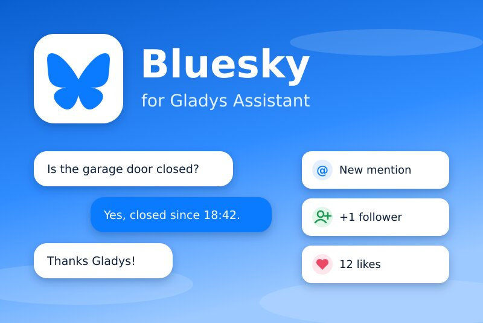
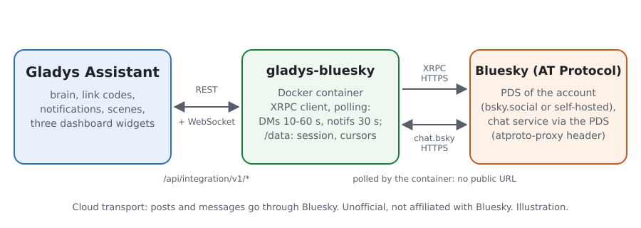
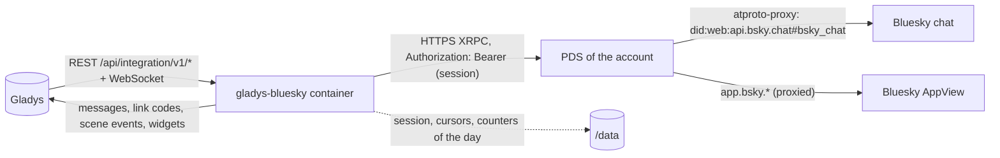
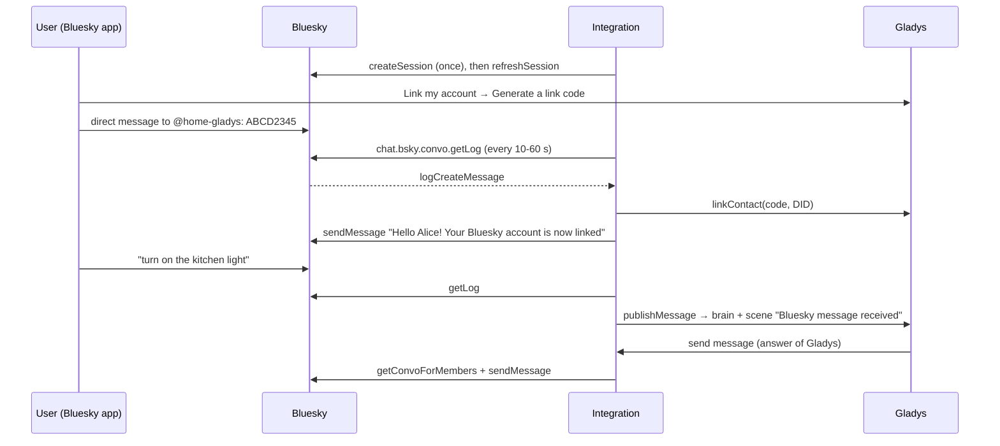
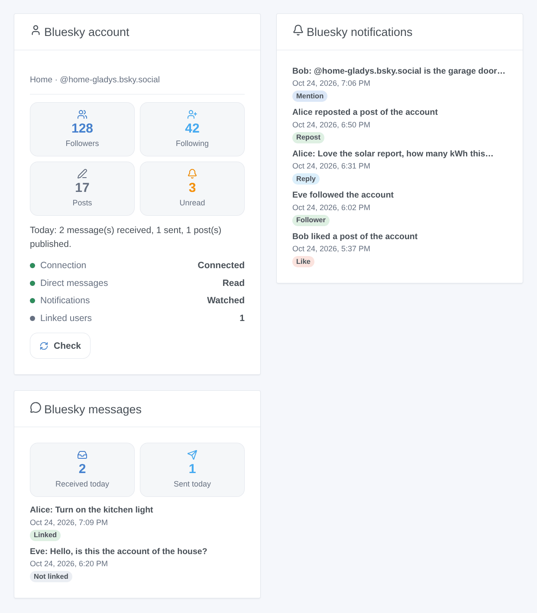

# Gladys Bluesky

**English** · [Français](README.fr.md) · [Deutsch](README.de.md) · [Español](README.es.md)

[](LICENSE)
[](https://github.com/William-De71/gladys-bluesky/releases)
[](https://github.com/William-De71/gladys-bluesky/actions/workflows/release.yml)
[](https://gladysassistant.com)



[Gladys Assistant](https://gladysassistant.com) external integration for **Bluesky**: talk to Gladys in Bluesky direct messages, receive her notifications there, publish posts from your scenes and let them react to mentions, replies, new followers, likes and reposts. It uses the official API of the AT Protocol with an **app password**: no webhook, no public URL, no Gladys Plus.

User documentation: [English](docs/en.md) · [Français](docs/fr.md) · [Deutsch](docs/de.md) · [Español](docs/es.md).

**Unofficial integration, not affiliated with Bluesky Social PBC.** **Not tested with a real Bluesky account yet**: it is tested against a fake PDS built from the official lexicons and the documentation of Bluesky (docs.bsky.app).

## Features

- **One Bluesky account for the house** (recommended: a dedicated account, e.g. `home-gladys.bsky.social`), opened with an app password allowed to read direct messages. The session is kept in `/data` and renewed (Bluesky allows 300 logins a day): no new login at each restart. Accounts on a self-hosted PDS work too.
- **Talk to Gladys**: each user links their own Bluesky account with the link code of Gladys sent in a direct message; their messages then go to Gladys, who answers in the same conversation, like the native Telegram integration. Notifications of Gladys arrive there too.
- **Safe by default**: messages of accounts that are not linked never reach Gladys and get no automatic answer (they only fire a dedicated scene trigger); the messages of the account itself, group conversations and messages read more than 15 minutes late are ignored.
- **9 scene triggers** (mention, reply, quote, new follower, like, repost, message of a linked user, message of an unlinked account, message not sent), **3 scene actions** (publish a post, send a direct message, delete a post) and **3 dashboard widgets** (account, notifications, direct messages).
- **Rich posts**: links, `#hashtags` and `@mentions` become clickable (facets computed in UTF-8 bytes, mentions resolved to DIDs), language of the post, reply in a thread, optional image with its alt text.
- **Within the limits of Bluesky**: direct messages read every 10 to 60 s, notifications every 30 s, pauses on HTTP 429 until `ratelimit-reset`, anti-flood on the scene actions (the same post once a minute, 30 posts an hour at most).
- Four languages everywhere: English, French, German, Spanish.

## How it works





From the link code to a conversation:



### Transport

`transports: ["cloud"]`: everything goes through Bluesky. The integration calls the XRPC API of the PDS of the account (read in the DID document returned at login: `bsky.social` is only the entryway), over HTTPS, with the session token in the `Authorization` header; direct messages go through the same PDS with the `atproto-proxy` header to the chat service of Bluesky. The messages exchanged with Gladys therefore go through the servers of Bluesky, and posts are public. The app password is a `secret` field of Gladys, never logged nor written to `/data`; `/data` holds the session (DID, PDS, access and refresh tokens, file mode 600), the cursors of the notifications and messages and the counters of the day.

## Create the app password

1. Create (or pick) the Bluesky account of the house, and sign in with it in the Bluesky app.
2. **Settings → Privacy and security → App passwords → Add App Password**, name it `Gladys`, check **Allow access to your direct messages**, create it and copy it (it is shown once).
3. In the chat settings of the account (**Chat → ⚙**, “Allow new messages from”), choose who may write to it: **Everyone** lets your family send a link code without being followed first.
4. In Gladys: Integrations → Bluesky → Configuration, enter the handle (or e-mail) and the app password, save.

Never enter the main password of the account: an account protected by an e-mail code (2FA) refuses it anyway, and an app password can be revoked alone.

## Scene triggers, actions and widgets



The images are **generated illustrations**, drawn from the real widget code on made-up accounts and messages, not screenshots.

**Widgets**:

- **Bluesky account**: followers, follows, posts, unread notifications, the messages and posts of the day, the connection, the state of the direct messages and of the notifications, the linked users and a **Check** button.
- **Bluesky notifications**: the last 8 mentions, replies, quotes, followers, likes and reposts, linking to bsky.app (setting: hide likes and reposts).
- **Bluesky messages**: direct messages received and sent today and the last 8 messages; their text only with the setting **Show the text of the messages** (off by default: a dashboard can be shared; kept in memory only).

**Scene triggers** (one event per new item, never what was already there at the first read, never because of a scene action):

| Trigger                          | Filters                 | Variables                                                                                   |
| -------------------------------- | ----------------------- | ------------------------------------------------------------------------------------------- |
| Mentioned on Bluesky             | author handle           | author handle, name and DID, text, AT URI and link of the post                              |
| Bluesky reply received           | author handle           | the same, plus the AT URI and link of the post of the account                               |
| Bluesky post quoted              | author handle           | the same as a reply                                                                         |
| New Bluesky follower             | author handle           | author handle, name and DID, link to the profile                                            |
| Bluesky like received            | author handle           | author handle, name and DID, AT URI and link of the liked post                              |
| Bluesky repost received          | author handle           | the same as a like                                                                          |
| Bluesky message received         | Gladys user, exact text | text, sender handle, name and DID, Gladys user and first name, conversation and message IDs |
| Message from an unlinked account | sender handle           | text, sender handle, name and DID, conversation and message IDs                             |
| Bluesky message not sent         | reason, Gladys user     | DID and handle of the user, Gladys user, first name, reason, Bluesky error code             |

**Scene actions**:

- **Publish a Bluesky post**: text (300 characters, shortened with … beyond), language (empty: the language of the integration), reply to (a bsky.app link or an `at://` URI, e.g. `{{triggerEvent.data.post_uri}}`), optional image URL (JPEG, PNG, WebP or GIF, 2 MB) and its description. Outputs: `uri`, `url`, `cid`. The same post less than a minute later is published once; 30 posts an hour at most (a looping scene stops there).
- **Send a Bluesky direct message**: to a handle, a DID or a profile link, linked or not (they must accept messages from the account). Outputs: `convo_id`, `message_id`. The same message to the same account less than a minute later is sent once.
- **Delete a Bluesky post**: a post of the account, e.g. the `url` output of an earlier publish.

Examples:

- **Mentioned on Bluesky** by `alice.bsky.social` → **Publish a Bluesky post** “The garage is closed ✅” with **Reply to** `{{triggerEvent.data.post_uri}}`.
- Every evening at 21:00 → **Publish a Bluesky post** “Solar production today: {{…}} kWh #solar”.
- **New Bluesky follower** → a notification to your phone with `{{triggerEvent.data.author_name}}`.

## Requirements

- Gladys Assistant **5.3.0** or later (dashboard widgets, scene triggers and actions, the catalog keywords of Gladys 5.3): older instances cannot install the integration.
- A Bluesky account (bsky.social or a self-hosted PDS) and an app password with access to direct messages.
- Internet access from Gladys (outgoing only: no port to open).

## Installation

- **From the store**: Integrations → Bluesky → Install.
- **From the repository URL**: Integrations → Install from a URL → `https://github.com/William-De71/gladys-bluesky`.
- **Developer mode**: run the container yourself with the variables Gladys shows (see Development).

## Configuration

| Field                              | Default               | Meaning                                                                     |
| ---------------------------------- | --------------------- | --------------------------------------------------------------------------- |
| Handle or e-mail of the account    | —                     | required: `name.bsky.social`, your own domain, or the e-mail address        |
| App password                       | —                     | required, secret, with access to direct messages                            |
| Server (advanced)                  | `https://bsky.social` | for an account on a self-hosted PDS: its `https://` address                 |
| Read the direct messages           | on                    | off: nobody can talk to Gladys nor link an account (Gladys can still send)  |
| Send the direct messages to Gladys | on                    | off: messages of linked users only reach the scenes                         |
| Check the direct messages every    | 15 s                  | 10, 15, 30 or 60 s (notifications: every 30 s, 60 s with the 60 s choice)   |
| Watch the notifications            | on                    | mentions, replies, quotes, followers, likes, reposts (never marked as read) |
| Language of the integration        | automatic             | the answer to a link code and the default language of the posts             |

**Test the connection** (configuration button) opens the session (also after a refused password), reads the profile, checks the access to direct messages and counts the linked users.

## Usage

1. Create the app password (above) and fill in the configuration.
2. Each user: **Link my account → Generate a link code** in the configuration of the integration, then send the code in a direct message to the account of the house within 15 minutes.
3. Write to the account of the house: Gladys answers. Allow its messages in your own chat settings to receive the alerts of Gladys.
4. Add the widgets to a dashboard; build scenes with the triggers and the actions.

## Development

```bash
npm install
npm test                       # node --test, a fake PDS on 127.0.0.1, never the network
npm run lint                   # ESLint
npm run format:check           # Prettier
npm run coverage               # node --test with coverage of src/
npx github:GladysAssistant/integration-store . --skip-image-check
scripts/build-cover.sh         # cover.jpg from docs/assets/cover.svg
docs/illustrations/render.sh   # docs/assets/widgets.<lang>.png
```

Locally, the SDK reads `GLADYS_HOST_API_URL`, `GLADYS_INTEGRATION_TOKEN` and `GLADYS_INTEGRATION_SELECTOR` (given by Gladys in developer mode). `DEBUG=gladys-integration-sdk` shows the SDK logs. The text of a message is never logged.

The tests cover the rich text (graphemes, UTF-8 facets, links, tags, mentions, splitting), the links and AT URIs, the configuration, the session (createSession once, refreshSession, a stored session reused, a refused password never retried alone, 2FA, an app password without direct messages), the rate limits (429 and `ratelimit-reset`), the images, `/data`, and the whole integration against the fake Gladys of the SDK and the fake PDS: references, linking, conversation, strangers, late messages, failures, notifications, the three actions, the widgets and the configuration button. `test/structure.test.js` freezes every key users store.

## Release process


Every merge on `main` runs the CI, then computes the version from the [Conventional Commits](https://www.conventionalcommits.org/) since the last tag: `feat` → minor, `fix` / `perf` → patch, `!` or `BREAKING CHANGE` → major (a minor below 1.0.0); `docs`, `chore`, `ci`, `test`, `style`, `refactor`, `build` alone publish nothing. The changelog section is generated, the tag pushed, the multi-architecture image built, then `main` receives the release commit, the GitHub Release is created and a last job checks the public image, the store validator and the topic.

- The pull request title becomes the squash commit, then the changelog line: write it in English, for the user (`pr-title.yml` checks it). Never edit `CHANGELOG.md` by hand.
- 1.0.0 is a decision: Actions → Release → Run workflow with `release-as: 1.0.0`. `dry-run` shows the version and the notes without publishing.
- **Protected branch**: the release pushes its commit to `main` with `GITHUB_TOKEN`. The `protect-main` ruleset (no deletion, no force-push) lets it through; a stricter rule (pull request required, status checks) would need GitHub Actions in its bypass list, or a GitHub App.
- After the first release, make the `ghcr.io` package public (Package settings → Change visibility), or Gladys cannot pull it.

## Troubleshooting

See [docs/en.md](docs/en.md#troubleshooting). Report issues with the versions of Gladys and of the integration, the message of **Test the connection** and the logs with `DEBUG=gladys-integration-sdk`. Never paste the app password nor private messages.

## Contributing

Issues and pull requests are welcome. Run `npm run format:check && npm run lint && npm test` before opening a pull request, and keep every stored key unchanged (see [CLAUDE.md](CLAUDE.md)). A test with a real account (logs without the password) helps more than anything.

## Security

See [SECURITY.md](SECURITY.md): report vulnerabilities privately. The app password is a `secret` field, sent only to the configured server at login, never logged nor written to `/data`; the session tokens in `/data/session.json` are readable by the container only (mode 600). Only linked users reach the brain of Gladys, and through it the authority of their Gladys user: link only people you trust. The image of a post becomes public: never point it at a camera of the house.

## Screenshots to come

The images above are illustrations, not screenshots. Real screenshots will go in `docs/assets/screenshots/` (PNG, 1280 × 800): `configuration.png` (the account fields and the help sections), `app-password.png` (the app password screen of Bluesky with the direct messages box), `link.png` (the link code sent in a direct message), `conversation.png` (a conversation with Gladys in the Bluesky app), `scene-mention.png` (the “Mentioned on Bluesky” trigger in a scene).

## Known limits

- Never tested with a real account: the payloads follow the official lexicons and the documentation of Bluesky, not a real session.
- Polling only (Bluesky offers no push to a home server): a direct message reaches Gladys within the chosen interval (15 s by default).
- Images cannot travel in a Bluesky direct message (the chat API has no image): a camera image sent by Gladys arrives as a short notice.
- Group conversations, reactions, and the starter pack, verification and subscribed-post notifications are not handled.
- Notifications stay unread in the Bluesky app (the integration never marks them as seen); the unread counter is the one of Bluesky.
- A link code expires after 15 minutes (Gladys).

## License

[Apache License 2.0](LICENSE) — see also [NOTICE](NOTICE). Bluesky and the butterfly logo are trademarks of Bluesky Social PBC; this project is not affiliated with it. The butterfly of the cover comes unchanged from [bluesky-social/social-app](https://github.com/bluesky-social/social-app) (`bskyembed/assets/logo.svg`). Thanks to the Gladys documentation and SDK, and to the documentation and lexicons of Bluesky (see NOTICE).
