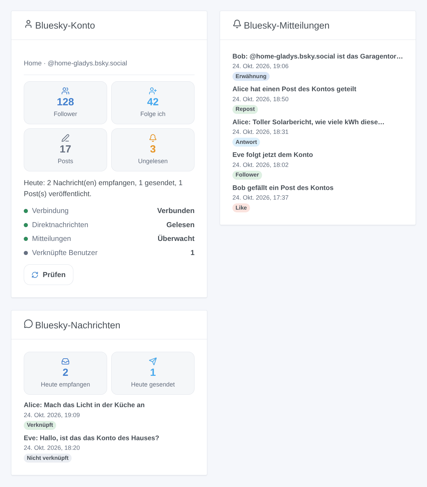

# Bluesky

Inoffizielle Integration, ohne Verbindung zu Bluesky Social PBC.

## Überblick

Die Bluesky-Integration verbindet Gladys mit **einem Bluesky-Konto**, am besten einem Konto des Hauses (z. B. `zuhause-gladys.bsky.social`):

- Jeder Benutzer von Gladys verknüpft einmal sein eigenes Bluesky-Konto und **schreibt dann per Direktnachricht mit Gladys** über das Konto des Hauses; die Mitteilungen von Gladys kommen dort ebenfalls an;
- deine **Szenen** reagieren auf Erwähnungen, Antworten, Zitate, neue Follower, Likes, Reposts und Direktnachrichten und können **einen Post veröffentlichen**, **eine Direktnachricht senden** oder **einen Post löschen**;
- drei **Dashboard-Widgets** zeigen das Konto, die letzten Mitteilungen und die letzten Direktnachrichten.

Alles läuft über die Server von Bluesky (Cloud-Transport): Die Integration fragt Bluesky regelmäßig ab (alle 10 bis 60 Sekunden für Direktnachrichten, alle 30 Sekunden für Mitteilungen). Gladys braucht weder eine öffentliche URL noch Gladys Plus. Posts sind öffentlich; Direktnachrichten bleiben zwischen den Konten.

## Voraussetzungen

- Gladys Assistant 5.3.0 oder neuer.
- Ein Bluesky-Konto (auf bsky.social oder auf einem selbst gehosteten PDS) und ein **App-Passwort** dieses Kontos mit Zugriff auf Direktnachrichten.
- Internetzugang von Gladys aus.

### App-Passwort erstellen

1. Melde dich in der Bluesky-App mit dem Konto des Hauses an.
2. Öffne **Einstellungen → Privatsphäre und Sicherheit → App-Passwörter → App-Passwort hinzufügen**.
3. Nenne es `Gladys` und aktiviere **Zugriff auf deine Direktnachrichten erlauben**: Sonst kann Gladys keine Direktnachrichten lesen oder senden.
4. Kopiere das Passwort (es wird nur einmal angezeigt).
5. Wähle in den Chat-Einstellungen des Kontos (**Chat → ⚙**, „Neue Nachrichten erlauben von“) **Allen**, damit deine Familie einen Verknüpfungscode senden kann, oder folge ihren Konten.

Gib nie das Hauptpasswort des Kontos ein: Ein durch einen E-Mail-Code geschütztes Konto lehnt es ab, und ein App-Passwort lässt sich jederzeit einzeln widerrufen.

## Konfiguration

Öffne in Gladys **Integrationen → Bluesky → Konfiguration**:

| Feld                               | Bedeutung                                                                                      |
| ---------------------------------- | ---------------------------------------------------------------------------------------------- |
| Handle oder E-Mail des Kontos      | `name.bsky.social` (ohne das @), deine eigene Domain oder die E-Mail-Adresse des Kontos        |
| App-Passwort                       | das oben erstellte App-Passwort (verschlüsselt gespeichert)                                    |
| Server (erweitert)                 | leer lassen für bsky.social; für einen selbst gehosteten PDS seine `https://`-Adresse          |
| Direktnachrichten lesen            | aus: Niemand kann mit Gladys schreiben oder ein Konto verknüpfen; Gladys kann weiter senden    |
| Direktnachrichten an Gladys senden | aus: Nachrichten verknüpfter Benutzer erreichen nur die Szenen                                 |
| Direktnachrichten prüfen alle      | 10, 15 (Standard), 30 oder 60 Sekunden                                                         |
| Mitteilungen überwachen            | Erwähnungen, Antworten, Zitate, Follower, Likes und Reposts für Szenen und Widgets             |
| Sprache der Integration            | die Antwort auf einen Verknüpfungscode und die Standardsprache der von Szenen gesendeten Posts |

Klicke auf **Verbindung testen**: Es zeigt das Konto, seine Follower, ob Direktnachrichten lesbar sind, und die Zahl der verknüpften Benutzer. Die Integration meldet sich einmal an und behält ihre Sitzung: Bluesky begrenzt Anmeldungen auf 300 pro Tag.

### Dein Bluesky-Konto verknüpfen

1. In der Konfiguration der Integration: **Mein Konto verknüpfen → Verknüpfungscode generieren**.
2. Sende in der Bluesky-App mit **deinem eigenen** Konto den Code innerhalb von 15 Minuten per Direktnachricht an das Konto des Hauses.
3. Das Konto des Hauses antwortet, dass dein Konto verknüpft ist.

Um die Meldungen von Gladys zu erhalten, muss dein eigenes Konto Nachrichten des Hauskontos annehmen (folge ihm oder erlaube Nachrichten von allen).

## Verwendung

### Mit Gladys schreiben

Schreib dem Konto des Hauses eine Direktnachricht: Gladys antwortet in derselben Unterhaltung, wie mit der Telegram-Integration. Lange Antworten werden auf mehrere Nachrichten aufgeteilt. Bluesky-Direktnachrichten können keine Bilder enthalten: Ein von Gladys gesendetes Kamerabild kommt als kurzer Hinweis an.

Nachrichten nicht verknüpfter Konten erreichen Gladys nie und erhalten keine Antwort: Sie bleiben in der App für einen Menschen ungelesen und lösen nur den Szenenauslöser **Nachricht eines fremden Kontos** aus.

### Dashboard-Widgets

_Generierte Illustration, kein Screenshot: erfundene Konten und Nachrichten._

- **Bluesky-Konto**: Follower, Abos, Posts, ungelesene Mitteilungen, Aktivität des Tages, Verbindung und eine Schaltfläche **Prüfen**.
- **Bluesky-Mitteilungen**: die letzten 8 Mitteilungen mit Link zu bsky.app; ist **Likes und Reposts anzeigen** aus, bleiben nur Erwähnungen, Antworten, Zitate und Follower.
- **Bluesky-Nachrichten**: heute empfangene und gesendete Nachrichten und die letzten 8 Nachrichten; ihr Text nur mit **Text der Nachrichten anzeigen** (standardmäßig aus, da ein Dashboard geteilt sein kann).

### Szenen

| Auslöser                         | Wann                                                                           |
| -------------------------------- | ------------------------------------------------------------------------------ |
| Auf Bluesky erwähnt              | jemand erwähnt das Konto in einem Post                                         |
| Bluesky-Antwort erhalten         | jemand antwortet auf einen Post des Kontos                                     |
| Bluesky-Post zitiert             | jemand zitiert einen Post des Kontos                                           |
| Neuer Bluesky-Follower           | jemand folgt dem Konto                                                         |
| Bluesky-Like erhalten            | jemandem gefällt ein Post des Kontos                                           |
| Bluesky-Repost erhalten          | jemand teilt einen Post des Kontos                                             |
| Bluesky-Nachricht empfangen      | ein verknüpfter Benutzer sendet eine Direktnachricht                           |
| Nachricht eines fremden Kontos   | ein anderes Konto sendet eine Direktnachricht (nie an Gladys)                  |
| Bluesky-Nachricht nicht gesendet | eine Nachricht von Gladys konnte nicht zugestellt werden (einmal pro Benutzer) |

Das erste Lesen nach dem Start ist die Referenz: Was schon da war, löst nichts aus. Die Aktionen sind **Bluesky-Post veröffentlichen** (Text, Sprache, Antwort auf einen Post, optionale Bild-URL und ihre Beschreibung), **Bluesky-Direktnachricht senden** und **Bluesky-Post löschen**. Derselbe Post innerhalb einer Minute wird einmal veröffentlicht, höchstens 30 Posts pro Stunde.

Beispiele:

- **Auf Bluesky erwähnt** → **Bluesky-Post veröffentlichen** mit **Antworten auf** `{{triggerEvent.data.post_uri}}`.
- Jeden Abend → **Bluesky-Post veröffentlichen** mit dem Solarertrag des Tages.
- **Nachricht eines fremden Kontos** → eine Mitteilung auf dein Handy mit `{{triggerEvent.data.sender_handle}}`.

## Fehlerbehebung

- **„Bluesky lehnt die Kennung oder das App-Passwort ab“**: Prüfe das Handle (ohne das @) und erstelle ein neues App-Passwort. Ein abgelehntes Passwort wird nicht von selbst erneut versucht: Speichere die Konfiguration erneut oder klicke auf **Verbindung testen**.
- **„Bluesky verlangt einen per E-Mail gesendeten Code“**: Das Hauptpasswort wurde eingegeben; nutze ein App-Passwort.
- **„Das App-Passwort erlaubt keine Direktnachrichten“**: Erstelle ein neues App-Passwort mit aktiviertem **Zugriff auf deine Direktnachrichten erlauben**.
- **Ein Benutzer erhält nichts**: Sein Konto muss Nachrichten des Hauskontos annehmen; der Auslöser **Bluesky-Nachricht nicht gesendet** nennt die Ursache.
- **Der Verknüpfungscode wird abgelehnt**: Er läuft nach 15 Minuten ab; generiere einen neuen.
- **„Bluesky bittet zu warten“**: zu viele Anfragen; die Integration wartet die von Bluesky genannte Zeit ab.
- Melde ein Problem mit den Versionen von Gladys und der Integration, der Meldung von **Verbindung testen** und den Protokollen (`DEBUG=gladys-integration-sdk`), nie mit dem App-Passwort: https://github.com/William-De71/gladys-bluesky/issues
