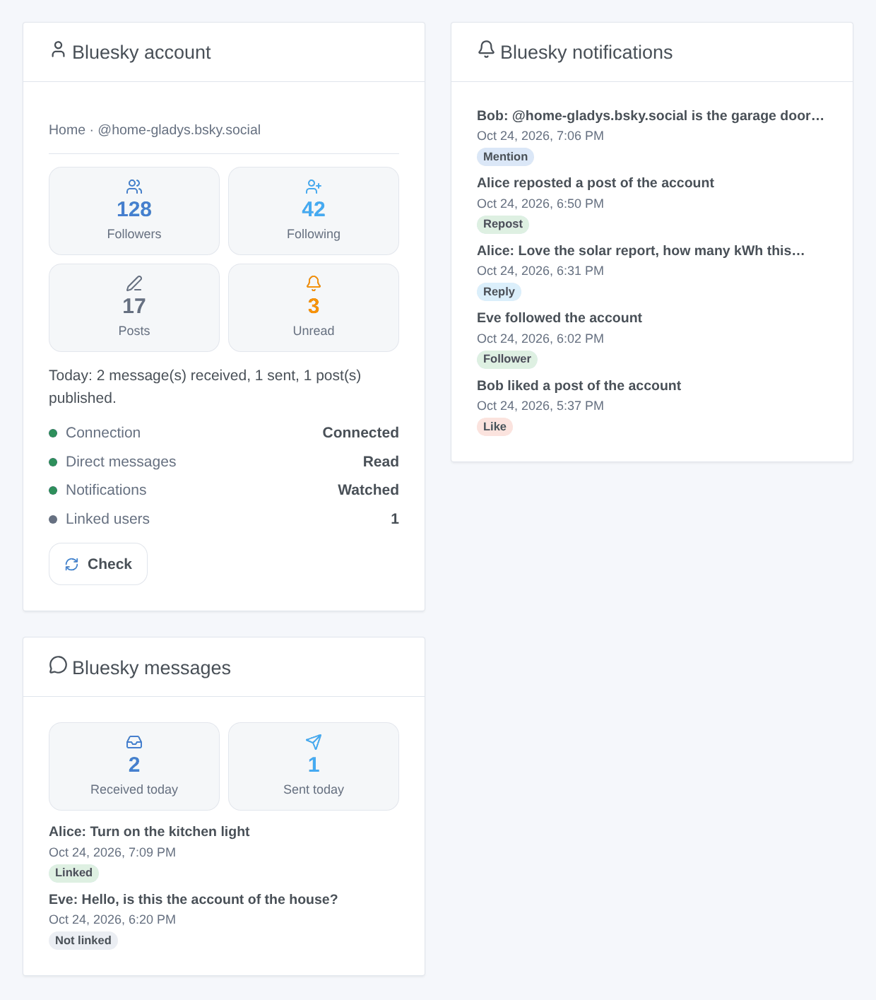

# Bluesky

Unofficial integration, not affiliated with Bluesky Social PBC.

## Overview

The Bluesky integration connects Gladys to **one Bluesky account**, ideally an account of the house (e.g. `home-gladys.bsky.social`):

- each user of Gladys links their own Bluesky account once, then **talks to Gladys in direct messages** to the account of the house; the notifications of Gladys arrive there too;
- your **scenes** react to mentions, replies, quotes, new followers, likes, reposts and direct messages, and can **publish a post**, **send a direct message** or **delete a post**;
- three **dashboard widgets** show the account, the last notifications and the last direct messages.

Everything goes through the servers of Bluesky (cloud transport): the integration asks Bluesky regularly (every 10 to 60 seconds for direct messages, every 30 seconds for notifications). Gladys needs no public URL and no Gladys Plus. Posts are public; direct messages are private between the accounts.

## Prerequisites

- Gladys Assistant 5.3.0 or later.
- A Bluesky account (on bsky.social or on a self-hosted PDS) and an **app password** of this account with access to direct messages.
- Internet access from Gladys.

### Create the app password

1. Sign in to the Bluesky app with the account of the house.
2. Open **Settings → Privacy and security → App passwords → Add App Password**.
3. Name it `Gladys` and check **Allow access to your direct messages**: without it, Gladys can neither read nor send direct messages.
4. Copy the password (it is shown once).
5. In the chat settings of the account (**Chat → ⚙**, “Allow new messages from”), choose **Everyone** so that your family can send a link code, or follow their accounts.

Never enter the main password of the account: an account protected by a code sent by e-mail refuses it, and an app password can be revoked on its own at any time.

## Configuration

In Gladys, open **Integrations → Bluesky → Configuration**:

| Field                              | Meaning                                                                                   |
| ---------------------------------- | ----------------------------------------------------------------------------------------- |
| Handle or e-mail of the account    | `name.bsky.social` (without the @), your own domain, or the e-mail address of the account |
| App password                       | the app password created above (stored encrypted)                                         |
| Server (advanced)                  | leave empty for bsky.social; for a self-hosted PDS, its `https://` address                |
| Read the direct messages           | off: nobody can talk to Gladys nor link an account; Gladys can still send messages        |
| Send the direct messages to Gladys | off: the messages of linked users only reach the scenes                                   |
| Check the direct messages every    | 10, 15 (default), 30 or 60 seconds                                                        |
| Watch the notifications            | mentions, replies, quotes, followers, likes and reposts for the scenes and the widgets    |
| Language of the integration        | the answer to a link code, and the default language of the posts published by the scenes  |

Click **Test the connection**: it shows the account, its followers, whether the direct messages are readable, and the number of linked users. The integration logs in once and keeps its session: Bluesky limits logins to 300 a day.

### Link your Bluesky account

1. In the configuration of the integration, **Link my account → Generate a link code**.
2. In the Bluesky app, with **your own** account, send the code in a direct message to the account of the house, within 15 minutes.
3. The account of the house answers that your account is linked.

To receive the alerts of Gladys, your own account must accept messages from the account of the house (follow it, or allow messages from everyone).

## Usage

### Talk with Gladys

Write to the account of the house in a direct message: Gladys answers in the same conversation, as with the Telegram integration. Long answers are split in several messages. Bluesky direct messages cannot carry images: a camera image sent by Gladys arrives as a short notice.

Messages from accounts that are not linked never reach Gladys and get no answer: they stay unread in the app for a human, and only fire the scene trigger **Message from an unlinked account**.

### Dashboard widgets

_Generated illustration, not a screenshot: made-up accounts and messages._

- **Bluesky account**: followers, follows, posts, unread notifications, today’s activity, the connection and a **Check** button.
- **Bluesky notifications**: the last 8 notifications, linking to bsky.app; the setting **Show likes and reposts** keeps only mentions, replies, quotes and followers when off.
- **Bluesky messages**: messages received and sent today and the last 8 messages; their text only with **Show the text of the messages** (off by default, since a dashboard can be shared).

### Scenes

| Trigger                          | When                                                       |
| -------------------------------- | ---------------------------------------------------------- |
| Mentioned on Bluesky             | someone mentions the account in a post                     |
| Bluesky reply received           | someone replies to a post of the account                   |
| Bluesky post quoted              | someone quotes a post of the account                       |
| New Bluesky follower             | someone follows the account                                |
| Bluesky like received            | someone likes a post of the account                        |
| Bluesky repost received          | someone reposts a post of the account                      |
| Bluesky message received         | a linked user sends a direct message                       |
| Message from an unlinked account | another account sends a direct message (never to Gladys)   |
| Bluesky message not sent         | a message of Gladys could not be delivered (once per user) |

The first read after the start is the reference: what was already there fires nothing. The actions are **Publish a Bluesky post** (text, language, reply to a post, optional image URL and its description), **Send a Bluesky direct message** and **Delete a Bluesky post**. The same post within a minute is published once, and 30 posts an hour at most.

Examples:

- **Mentioned on Bluesky** → **Publish a Bluesky post** with **Reply to** `{{triggerEvent.data.post_uri}}`.
- Every evening → **Publish a Bluesky post** with the solar production of the day.
- **Message from an unlinked account** → a notification to your phone with `{{triggerEvent.data.sender_handle}}`.

## Troubleshooting

- **“Bluesky refuses the identifier or the app password”**: check the handle (without the @) and create a new app password. A refused password is not retried on its own: save the configuration again or click **Test the connection**.
- **“Bluesky asks for a code sent by e-mail”**: the main password was entered; use an app password.
- **“The app password does not allow direct messages”**: create a new app password with **Allow access to your direct messages** checked.
- **A user receives nothing**: their account must accept messages from the account of the house; the scene trigger **Bluesky message not sent** tells the reason.
- **The link code is refused**: it expires after 15 minutes; generate a new one.
- **“Bluesky asks to wait”**: too many requests; the integration waits for the time Bluesky gives.
- Report a problem with the versions of Gladys and of the integration, the message of **Test the connection** and the logs (`DEBUG=gladys-integration-sdk`), never the app password: https://github.com/William-De71/gladys-bluesky/issues
