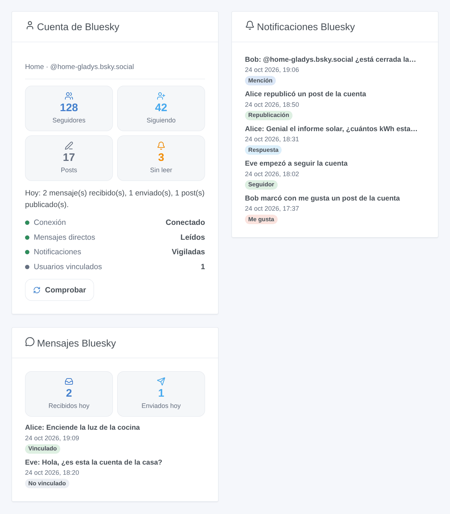

# Bluesky

Integración no oficial, sin relación con Bluesky Social PBC.

## Presentación

La integración Bluesky conecta Gladys con **una cuenta de Bluesky**, idealmente una cuenta de la casa (p. ej. `casa-gladys.bsky.social`):

- cada usuario de Gladys vincula una vez su propia cuenta de Bluesky y luego **habla con Gladys por mensajes directos** a la cuenta de la casa; las notificaciones de Gladys también llegan allí;
- sus **escenas** reaccionan a menciones, respuestas, citas, nuevos seguidores, me gusta, republicaciones y mensajes directos, y pueden **publicar un post**, **enviar un mensaje directo** o **eliminar un post**;
- tres **widgets del panel** muestran la cuenta, las últimas notificaciones y los últimos mensajes directos.

Todo pasa por los servidores de Bluesky (transporte en la nube): la integración consulta Bluesky con regularidad (cada 10 a 60 segundos para los mensajes directos, cada 30 segundos para las notificaciones). Gladys no necesita URL pública ni Gladys Plus. Los posts son públicos; los mensajes directos quedan entre las cuentas.

## Requisitos

- Gladys Assistant 5.3.0 o posterior.
- Una cuenta de Bluesky (en bsky.social o en un PDS autoalojado) y una **contraseña de aplicación** de esta cuenta con acceso a los mensajes directos.
- Acceso a Internet desde Gladys.

### Crear la contraseña de aplicación

1. Inicie sesión en la app de Bluesky con la cuenta de la casa.
2. Abra **Ajustes → Privacidad y seguridad → Contraseñas de aplicación → Añadir contraseña de aplicación**.
3. Llámela `Gladys` y marque **Permitir el acceso a tus mensajes directos**: sin ello, Gladys no puede leer ni enviar mensajes directos.
4. Copie la contraseña (solo se muestra una vez).
5. En los ajustes de chat de la cuenta (**Chat → ⚙**, «Permitir mensajes nuevos de»), elija **Todos** para que su familia pueda enviar un código de vinculación, o siga sus cuentas.

No introduzca nunca la contraseña principal de la cuenta: una cuenta protegida por un código enviado por correo la rechaza, y una contraseña de aplicación se puede revocar sola en cualquier momento.

## Configuración

En Gladys, abra **Integraciones → Bluesky → Configuración**:

| Campo                                 | Significado                                                                                 |
| ------------------------------------- | ------------------------------------------------------------------------------------------- |
| Alias o correo de la cuenta           | `nombre.bsky.social` (sin la @), su propio dominio o la dirección de correo de la cuenta    |
| Contraseña de aplicación              | la contraseña de aplicación creada arriba (guardada cifrada)                                |
| Servidor (avanzado)                   | déjelo vacío para bsky.social; para un PDS autoalojado, su dirección `https://`             |
| Leer los mensajes directos            | desactivado: nadie puede hablar con Gladys ni vincular una cuenta; Gladys aún puede enviar  |
| Enviar los mensajes directos a Gladys | desactivado: los mensajes de los usuarios vinculados solo llegan a las escenas              |
| Comprobar los mensajes directos cada  | 10, 15 (por defecto), 30 o 60 segundos                                                      |
| Vigilar las notificaciones            | menciones, respuestas, citas, seguidores, me gusta y republicaciones para escenas y widgets |
| Idioma de la integración              | la respuesta a un código de vinculación y el idioma por defecto de los posts de las escenas |

Pulse **Probar la conexión**: muestra la cuenta, sus seguidores, si los mensajes directos son legibles y el número de usuarios vinculados. La integración inicia sesión una vez y conserva su sesión: Bluesky limita los inicios de sesión a 300 al día.

### Vincular su cuenta de Bluesky

1. En la configuración de la integración, **Vincular mi cuenta → Generar un código de vinculación**.
2. En la app de Bluesky, con **su propia** cuenta, envíe el código por mensaje directo a la cuenta de la casa en un plazo de 15 minutos.
3. La cuenta de la casa responde que su cuenta está vinculada.

Para recibir los avisos de Gladys, su propia cuenta debe aceptar los mensajes de la cuenta de la casa (sígala o permita los mensajes de todos).

## Uso

### Hablar con Gladys

Escriba a la cuenta de la casa por mensaje directo: Gladys responde en la misma conversación, como con la integración de Telegram. Las respuestas largas se dividen en varios mensajes. Los mensajes directos de Bluesky no admiten imágenes: una imagen de cámara enviada por Gladys llega como un breve aviso.

Los mensajes de cuentas no vinculadas nunca llegan a Gladys ni reciben respuesta: siguen sin leer en la app para una persona y solo activan el disparador de escena **Mensaje de cuenta no vinculada**.

### Widgets del panel

_Ilustración generada, no una captura de pantalla: cuentas y mensajes inventados._

- **Cuenta de Bluesky**: seguidores, seguidos, posts, notificaciones sin leer, actividad del día, conexión y un botón **Comprobar**.
- **Notificaciones Bluesky**: las últimas 8 notificaciones con enlace a bsky.app; con **Mostrar me gusta y republicaciones** desactivado solo quedan menciones, respuestas, citas y seguidores.
- **Mensajes Bluesky**: mensajes recibidos y enviados hoy y los últimos 8 mensajes; su texto solo con **Mostrar el texto de los mensajes** (desactivado por defecto, ya que un panel puede compartirse).

### Escenas

| Disparador                        | Cuándo                                                        |
| --------------------------------- | ------------------------------------------------------------- |
| Mencionado en Bluesky             | alguien menciona la cuenta en un post                         |
| Respuesta de Bluesky recibida     | alguien responde a un post de la cuenta                       |
| Post de Bluesky citado            | alguien cita un post de la cuenta                             |
| Nuevo seguidor de Bluesky         | alguien empieza a seguir la cuenta                            |
| Me gusta de Bluesky recibido      | a alguien le gusta un post de la cuenta                       |
| Republicación de Bluesky recibida | alguien republica un post de la cuenta                        |
| Mensaje de Bluesky recibido       | un usuario vinculado envía un mensaje directo                 |
| Mensaje de cuenta no vinculada    | otra cuenta envía un mensaje directo (nunca llega a Gladys)   |
| Mensaje de Bluesky no enviado     | un mensaje de Gladys no pudo entregarse (una vez por usuario) |

La primera lectura tras el inicio sirve de referencia: lo que ya estaba no activa nada. Las acciones son **Publicar un post de Bluesky** (texto, idioma, respuesta a un post, URL de imagen opcional y su descripción), **Enviar un mensaje directo de Bluesky** y **Eliminar un post de Bluesky**. El mismo post en menos de un minuto se publica una vez, y 30 posts por hora como máximo.

Ejemplos:

- **Mencionado en Bluesky** → **Publicar un post de Bluesky** con **Responder a** `{{triggerEvent.data.post_uri}}`.
- Cada noche → **Publicar un post de Bluesky** con la producción solar del día.
- **Mensaje de cuenta no vinculada** → una notificación en su teléfono con `{{triggerEvent.data.sender_handle}}`.

## Solución de problemas

- **«Bluesky rechaza el identificador o la contraseña de aplicación»**: compruebe el alias (sin la @) y cree una nueva contraseña de aplicación. Una contraseña rechazada no se reintenta sola: guarde de nuevo la configuración o pulse **Probar la conexión**.
- **«Bluesky pide un código enviado por correo»**: se introdujo la contraseña principal; use una contraseña de aplicación.
- **«La contraseña de aplicación no permite mensajes directos»**: cree una nueva contraseña de aplicación marcando **Permitir el acceso a tus mensajes directos**.
- **Un usuario no recibe nada**: su cuenta debe aceptar los mensajes de la cuenta de la casa; el disparador **Mensaje de Bluesky no enviado** indica la causa.
- **El código de vinculación se rechaza**: caduca a los 15 minutos; genere uno nuevo.
- **«Bluesky pide esperar»**: demasiadas solicitudes; la integración espera el tiempo que indica Bluesky.
- Informe de un problema con las versiones de Gladys y de la integración, el mensaje de **Probar la conexión** y los registros (`DEBUG=gladys-integration-sdk`), nunca con la contraseña de aplicación: https://github.com/William-De71/gladys-bluesky/issues
