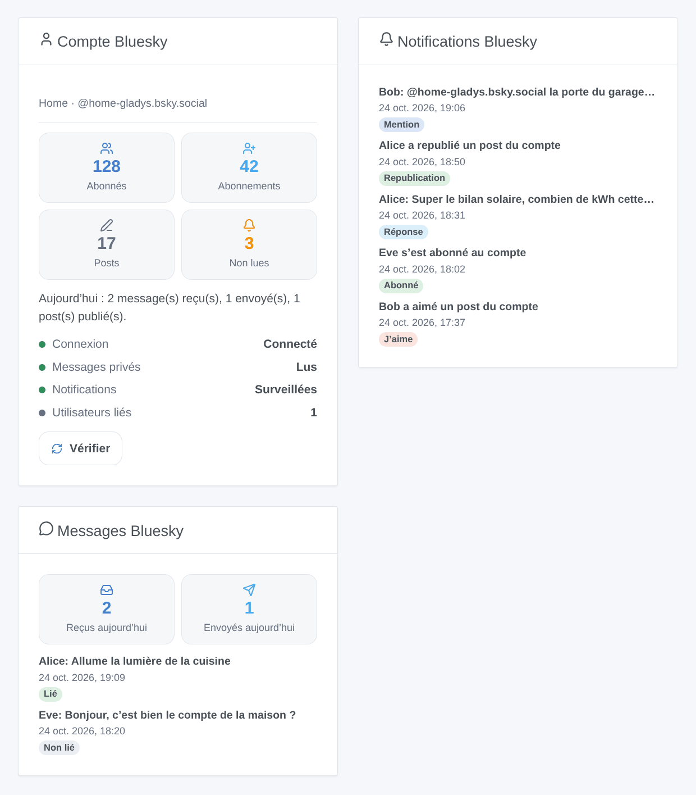

# Bluesky

Intégration non officielle, sans lien avec Bluesky Social PBC.

## Présentation

L’intégration Bluesky relie Gladys à **un compte Bluesky**, idéalement un compte de la maison (ex. `maison-gladys.bsky.social`) :

- chaque utilisateur de Gladys lie une fois son propre compte Bluesky, puis **parle à Gladys en messages privés** au compte de la maison ; les notifications de Gladys y arrivent aussi ;
- vos **scènes** réagissent aux mentions, réponses, citations, nouveaux abonnés, j’aime, republications et messages privés, et peuvent **publier un post**, **envoyer un message privé** ou **supprimer un post** ;
- trois **widgets de tableau de bord** montrent le compte, les dernières notifications et les derniers messages privés.

Tout passe par les serveurs de Bluesky (transport cloud) : l’intégration interroge Bluesky régulièrement (toutes les 10 à 60 secondes pour les messages privés, toutes les 30 secondes pour les notifications). Gladys n’a besoin ni d’URL publique ni de Gladys Plus. Les posts sont publics ; les messages privés restent entre les comptes.

## Prérequis

- Gladys Assistant 5.3.0 ou plus récent.
- Un compte Bluesky (sur bsky.social ou sur un PDS auto-hébergé) et un **mot de passe d’application** de ce compte avec l’accès aux messages privés.
- Un accès Internet depuis Gladys.

### Créer le mot de passe d’application

1. Connectez-vous à l’app Bluesky avec le compte de la maison.
2. Ouvrez **Réglages → Confidentialité et sécurité → Mots de passe d’application → Ajouter un mot de passe d’application**.
3. Nommez-le `Gladys` et cochez **Autoriser l’accès à vos messages privés** : sans cela, Gladys ne peut ni lire ni envoyer de messages privés.
4. Copiez le mot de passe (il n’est affiché qu’une fois).
5. Dans les réglages de discussion du compte (**Discussions → ⚙**, « Autoriser les nouveaux messages de »), choisissez **Tout le monde** pour que votre famille puisse envoyer un code de liaison, ou abonnez-vous à leurs comptes.

Ne saisissez jamais le mot de passe principal du compte : un compte protégé par un code envoyé par e-mail le refuse, et un mot de passe d’application se révoque seul à tout moment.

## Configuration

Dans Gladys, ouvrez **Intégrations → Bluesky → Configuration** :

| Champ                                   | Rôle                                                                                          |
| --------------------------------------- | --------------------------------------------------------------------------------------------- |
| Pseudo ou e-mail du compte              | `nom.bsky.social` (sans le @), votre propre domaine, ou l’adresse e-mail du compte            |
| Mot de passe d’application              | le mot de passe d’application créé ci-dessus (stocké chiffré)                                 |
| Serveur (avancé)                        | laissez vide pour bsky.social ; pour un PDS auto-hébergé, son adresse `https://`              |
| Lire les messages privés                | désactivé : personne ne peut parler à Gladys ni lier un compte ; Gladys peut toujours envoyer |
| Envoyer les messages privés à Gladys    | désactivé : les messages des utilisateurs liés n’atteignent que les scènes                    |
| Vérifier les messages privés toutes les | 10, 15 (par défaut), 30 ou 60 secondes                                                        |
| Surveiller les notifications            | mentions, réponses, citations, abonnés, j’aime et republications pour les scènes et widgets   |
| Langue de l’intégration                 | la réponse à un code de liaison, et la langue par défaut des posts publiés par les scènes     |

Cliquez sur **Tester la connexion** : il affiche le compte, ses abonnés, si les messages privés sont lisibles, et le nombre d’utilisateurs liés. L’intégration se connecte une fois et garde sa session : Bluesky limite les connexions à 300 par jour.

### Lier votre compte Bluesky

1. Dans la configuration de l’intégration, **Lier mon compte → Générer un code de liaison**.
2. Dans l’app Bluesky, avec **votre propre** compte, envoyez le code en message privé au compte de la maison, dans les 15 minutes.
3. Le compte de la maison répond que votre compte est lié.

Pour recevoir les alertes de Gladys, votre propre compte doit accepter les messages du compte de la maison (abonnez-vous à lui, ou autorisez les messages de tout le monde).

## Utilisation

### Discuter avec Gladys

Écrivez au compte de la maison en message privé : Gladys répond dans la même conversation, comme avec l’intégration Telegram. Les longues réponses sont découpées en plusieurs messages. Les messages privés Bluesky ne peuvent pas contenir d’image : une image de caméra envoyée par Gladys arrive sous forme d’un court avis.

Les messages des comptes non liés n’atteignent jamais Gladys et ne reçoivent aucune réponse : ils restent non lus dans l’app pour un humain, et déclenchent seulement le déclencheur de scène **Message d’un compte non lié**.

### Widgets de tableau de bord

_Illustration générée, pas une capture d’écran : comptes et messages inventés._

- **Compte Bluesky** : abonnés, abonnements, posts, notifications non lues, activité du jour, connexion et un bouton **Vérifier**.
- **Notifications Bluesky** : les 8 dernières notifications, avec un lien vers bsky.app ; désactivé, le réglage **Afficher j’aime et republications** ne garde que mentions, réponses, citations et abonnés.
- **Messages Bluesky** : messages reçus et envoyés aujourd’hui et les 8 derniers messages ; leur texte seulement avec **Afficher le texte des messages** (désactivé par défaut, un tableau de bord pouvant être partagé).

### Scènes

| Déclencheur                 | Quand                                                                 |
| --------------------------- | --------------------------------------------------------------------- |
| Mentionné sur Bluesky       | quelqu’un mentionne le compte dans un post                            |
| Réponse Bluesky reçue       | quelqu’un répond à un post du compte                                  |
| Post Bluesky cité           | quelqu’un cite un post du compte                                      |
| Nouvel abonné Bluesky       | quelqu’un s’abonne au compte                                          |
| J’aime Bluesky reçu         | quelqu’un aime un post du compte                                      |
| Republication Bluesky reçue | quelqu’un republie un post du compte                                  |
| Message Bluesky reçu        | un utilisateur lié envoie un message privé                            |
| Message d’un compte non lié | un autre compte envoie un message privé (jamais transmis à Gladys)    |
| Message Bluesky non envoyé  | un message de Gladys n’a pas pu être remis (une fois par utilisateur) |

La première lecture après le démarrage sert de référence : ce qui était déjà là ne déclenche rien. Les actions sont **Publier un post Bluesky** (texte, langue, réponse à un post, URL d’image facultative et sa description), **Envoyer un message privé Bluesky** et **Supprimer un post Bluesky**. Le même post dans la minute n’est publié qu’une fois, et 30 posts par heure au plus.

Exemples :

- **Mentionné sur Bluesky** → **Publier un post Bluesky** avec **Répondre à** `{{triggerEvent.data.post_uri}}`.
- Chaque soir → **Publier un post Bluesky** avec la production solaire du jour.
- **Message d’un compte non lié** → une notification sur votre téléphone avec `{{triggerEvent.data.sender_handle}}`.

## Dépannage

- **« Bluesky refuse l’identifiant ou le mot de passe d’application »** : vérifiez le pseudo (sans le @) et créez un nouveau mot de passe d’application. Un mot de passe refusé n’est pas retenté tout seul : enregistrez de nouveau la configuration ou cliquez sur **Tester la connexion**.
- **« Bluesky demande un code envoyé par e-mail »** : le mot de passe principal a été saisi ; utilisez un mot de passe d’application.
- **« Le mot de passe d’application n’autorise pas les messages privés »** : créez un nouveau mot de passe d’application en cochant **Autoriser l’accès à vos messages privés**.
- **Un utilisateur ne reçoit rien** : son compte doit accepter les messages du compte de la maison ; le déclencheur **Message Bluesky non envoyé** en donne la cause.
- **Le code de liaison est refusé** : il expire au bout de 15 minutes ; générez-en un nouveau.
- **« Bluesky demande de patienter »** : trop de requêtes ; l’intégration attend le délai indiqué par Bluesky.
- Signalez un problème avec les versions de Gladys et de l’intégration, le message de **Tester la connexion** et les journaux (`DEBUG=gladys-integration-sdk`), jamais le mot de passe d’application : https://github.com/William-De71/gladys-bluesky/issues
